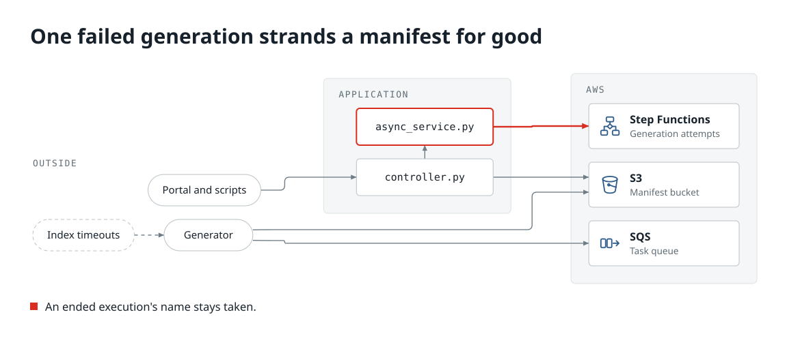

# One failed generation strands a manifest for good

A manifest service names each Step Functions execution after the manifest. Once one run fails, that name stays taken, so every later request is sent back to the same failure.

## The system
A portal requests file manifests with `PUT /v1/manifests`, answered by several instances. If the manifest is already in S3, the client gets its location. Otherwise the service starts an execution of the Standard state machine `manifest-gen`, which puts a task on the SQS queue `manifest-gen-tasks`, and the client polls a token. A generator consumes the task, writes to S3 and reports back. Every instance computes the same execution name, `<generation id>_<iteration>`, so concurrent requests share one run.

## What goes wrong
- After one generation fails with `IndexUnavailable`, every request for that manifest ends in HTTP 500 with `Manifest generation failed`.
- Fresh and later requests get the same.
- The generator is never asked again, and only a catalog reindex, which changes every manifest key, has helped.

## Where the issue is
`_start_execution` in `controller.py` starts a fresh request at iteration 0. In `async_service.py`, `start_generation` catches `ExecutionAlreadyExists` and assumes the attempt ended well enough to poll, so the client gets the failed attempt's token. An ended execution's name cannot be reused for 90 days, and iteration only advances after a success whose manifest has gone. The controller also caps iterations, a limit failures can exhaust.

The correct shape reads the taken name's status: join if `RUNNING`, serve the result if `SUCCEEDED`, otherwise move to the next name. Input must be serialized canonically, because Step Functions joins only on identical input and requests may order filters differently.

## What a correct fix must do
- Produce the manifest on the next request once the index is healthy, however many attempts failed.
- Keep bursts across instances sharing exactly one new execution, including right after a failure.
- Keep answering 500 to anyone polling a failed attempt's token, and start nothing without a client request.
- Stay within Step Functions quotas. `DescribeExecution` refills at 15 per second, so walking every old name per request fails.

## How it is graded
Each test gets a deployment on a local AWS-compatible emulator, three service processes, and a stand-in generator that holds each task until the test decides its outcome. All calls pass through a proxy that throttles Step Functions at the documented quotas. Bursts of identical requests with reordered filters must produce one new execution, through 14 to 16 failures, then 42 to 48, with instances restarted midway. Others cover an aborted run, expiry then failed regeneration, and a request stalled past a success.

## Why it is hard
The name does two jobs: it merges concurrent requests, and it records a failure for 90 days. Every instance must agree on moving on, with no shared memory, at a cost independent of failure history.

## Real-world basis
Modelled on a failure publicly reported against an open-source data portal's manifest service.

## Task facts

| | |
|---|---|
| Task | `swe-cloud/if-sfn-s3-manifest-stuck-after-failed-run` |
| Type | Issue fixing |
| AWS services | S3, Step Functions, SQS |
| Language | Python |
| Runtime | Local AWS-compatible emulator. No internet access. |
| Hidden tests | 5 test functions |
| Expert estimate | 4 hours |
| Agent time limit | 1 hour |
| Resources | 2 CPUs, 3 GB memory |
