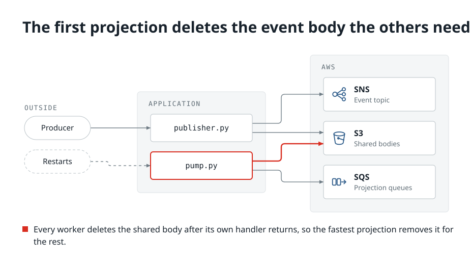

# The first projection deletes the event body the others need

An SNS fan-out keeps event bodies in S3. The first subscriber to finish deletes the shared body, so other projections fail and error-queue replays can never succeed.

## The system
A dispatch service delivers each event to a fixed set of business projections. The publisher stores the original bytes as one S3 object, `body_prefix + event_id`, then publishes a small JSON pointer (`event_id`, `body_key`, `sha256`) to an SNS topic. Each projection has its own SQS queue, and its worker fetches the body and calls a handler. Failed work goes to an error queue, where operators may leave it for minutes before replaying it. Each body must disappear within 10 seconds after the last projection finishes.

## What goes wrong
- Publishes report success, but some projections never catch up.
- Notifications in the error queue still fail when replayed.
- It is worse around restarts or when one projection is behind.
- Producer retries succeed but leave storage behind.
- Some killed publish commands never reach the projections.

## Where the issue is
After a successful handler, `process` in `pump.py` calls `DeleteObject` on the body. That object is shared, so the fastest projection removes it for the rest. The next `GetObject` fails, the message goes to the error queue, and replay cannot help.

In `publisher.py`, a crash between `PutObject` and `Publish` strands the event. A retry of a completed event uploads the body and notifies again, so reclaimed storage returns and finished work reruns, and a reused ID overwrites the object.

The right shape is a small DynamoDB record per event holding a publication intent and the set of projections still pending. Only an empty set may delete the body.

## What a correct fix must do
- Deliver the original bytes to every projection, including after dwell and replay in the error queue.
- Delete each body within 10 seconds of the last completion, resuming across restarts.
- Recover an uploaded event within 15 seconds, even if the producer never returns.
- Never recreate a reclaimed body, and reject a reused ID with different bytes, even after reclamation.
- Treat repeat notifications as already done. Keeping bodies forever does not count.

## How it is graded
Real worker and publisher processes run against emulated services. Host-controlled pause points kill a worker after fetch, handler, record or ack, and kill a publisher after upload or after SNS accepts. A blocked projection's event waits in the error queue for 26 seconds before replay. Late projections start after others finish, duplicates arrive after completion, and retries run with subscribers stopped. Tests sample the bucket and compare handler receipts.

## Why it is hard
An SNS result can be unknown after the body is already gone, so recovery must not require the object. A duplicate must not become poison once its body is reclaimed.

## Real-world basis
Modelled on a failure publicly reported against an open-source messaging library's SQS transport, involving large bodies held in S3.

## Task facts

| | |
|---|---|
| Task | `swe-cloud/if-sns-s3-fan-out-intermittent-delivery-loss` |
| Type | Issue fixing |
| AWS services | SNS, S3, SQS |
| Language | Python |
| Runtime | Local AWS-compatible emulator. No internet access. |
| Hidden tests | 7 test functions |
| Expert estimate | 4 hours |
| Agent time limit | 1 hour |
| Resources | 2 CPUs, 3 GB memory |
