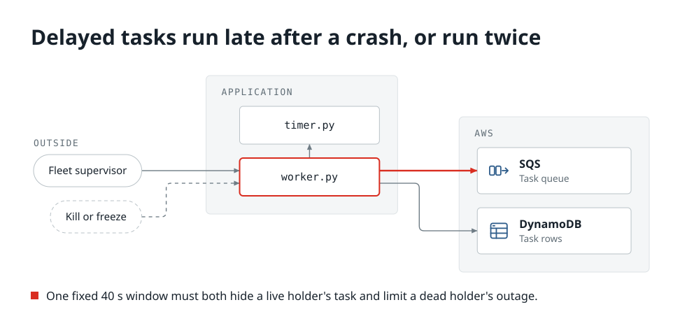

# Delayed tasks run late after a crash, or run twice

A delayed-task runner hides SQS deliveries for 40 seconds, so a killed worker's task stays stuck, while shorter windows bring duplicates and the DynamoDB row cannot say who may commit.

## The system
Producers publish tasks with an absolute `due_at` to a standard SQS queue. `worker.py` takes each delivery at once, hides it, writes the holder onto a DynamoDB row, and keeps the task on an in-memory schedule. At the due time it increments `effect_count`, marks the row `DONE` and deletes the delivery. A supervisor drives workers with `RECEIVE` and `ADOPT`, and replaces unreachable ones under the same `--worker-id`.

## What goes wrong
- A task ran twice under the queue's 4 second default, with `effect_count = 2` from two workers holding copies.
- After on-call raised the window to 40 seconds, a task due in 25 seconds whose holder was killed at 6 seconds committed 15 seconds late.
- Three times this month an effect was committed by something other than the holder of record, including a frozen process that thawed after its replacement took over.

## Where the issue is
`settings.py` sets one `VISIBILITY_S = 40`, and `take_delivery` applies it once. That one window sets both how long a live holder hides a future task and how long a dead holder's work stays unreachable.

`store.py` is the other half. `record_task` overwrites `holder` unconditionally, so any copy moves the task, and `commit_effect` increments without a condition. Standard queues can deliver a copy while an earlier one is hidden, so a shorter window alone brings duplicates back.

The right shape is a short window the holder keeps renewing, plus a conditional claim on the row with a fence, checked at commit.

## What a correct fix must do
- Commit once, at or after `due_at`, within 2 seconds of it.
- Bring a killed holder's own message back to another worker within 8 seconds. Republishing or diverting to another queue does not count.
- Let a copy delivered to another worker leave the running holder in place.
- Show takeovers in the row, and stop a replaced process from committing, even one with the same worker id.
- Keep `effect_count` an increment.

## How it is graded
Tests drive real workers against one queue and table. They SIGKILL a holder and check with plain receives that the original message returns, adopt copies onto running workers, SIGSTOP a holder until the supervisor starts a replacement under its id, and stop that replacement across the due time. Row samples track holders.

## Why it is hard
Renewal fixes the delay but allows copies, so ownership must move to the row. Worker id can't identify the owner once a replacement shares it, so the claim needs an epoch. A suspended process also has to find out it lost, and stand down when it resumes.

## Real-world basis
Modelled on a failure publicly reported against an open-source task queue's delayed tasks on SQS.

## Task facts

| | |
|---|---|
| Task | `swe-cloud/if-sqs-dynamodb-delayed-task-holder-crash` |
| Type | Issue fixing |
| AWS services | SQS, DynamoDB |
| Language | Python |
| Runtime | Local AWS-compatible emulator. No internet access. |
| Hidden tests | 11 test functions |
| Expert estimate | 4 hours |
| Agent time limit | 1 hour |
| Resources | 2 CPUs, 3 GB memory |
