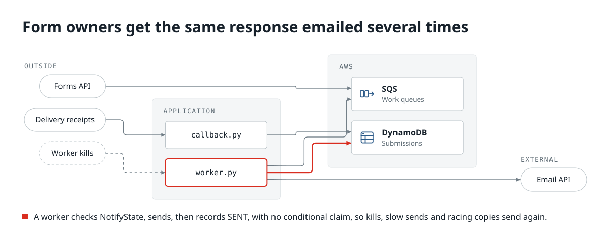

# Form owners get the same response emailed several times

Workers email form submissions from SQS through a non-idempotent API. Kills, slow sends, racing copies and repeated failure callbacks all produce duplicates.

## The system
The forms API writes each submission to the DynamoDB table `ReliabilityQueue` and drops a pointer on `submission-queue`. Up to four workers poll that queue and `reprocess-queue`, and post each response to an external email API. That API has no idempotency: every accepted POST is an email, even if the caller dies before reading the reply. It then calls back with delivery status, and for a transient failure the callback server requeues the submission for one replacement. The queues have a 12 second visibility timeout.

## What goes wrong
- Owners receive one response two or three times, as separate notifications seconds apart.
- Reports cluster around worker replacements, slow email API afternoons, and days with many full-inbox bounces.
- One owner with a briefly full inbox got three copies.

## Where the issue is
`worker.py` reads `NotifyState`, sends, and only then writes `SENT` from `store.py`. Nothing claims the item, so a kill after acceptance, a send outlasting the visibility timeout, or two copies of a message all send again. `callback.py` is keyed on the submission alone. Any failure callback resets `NotifyState` to `PENDING` and requeues, even a repeat, or one about an email already replaced.

The right shape is a conditional claim with a lease, a reference per attempt, and a lookup by reference on takeover, using the API's guarantee that an accepted send is listed within 2 seconds.

## What a correct fix must do
- Send one email per submission, plus exactly one replacement after `temporary-failure` or `technical-failure`.
- Lose nothing when a worker dies at any point, and still send within a minute.
- End with `SENT`, `DELIVERED` or `FAILED`, and `NotificationId` naming the email accepted last.
- Leave queues and the DLQ empty, with queue attributes unchanged.
- Take over what the old code left at deploy time: stale `PENDING` marks and unrecorded sends.
- Never resend old finished submissions, whose emails the API forgets after 7 days.

## How it is graded
The tests start real workers and a callback server against a stub email API with a fault plan and the same 1000 requests per minute limit. They kill workers before and after acceptance, hold a send past the visibility timeout, race two copies, repeat and delay failure callbacks, and deploy over state left by the old version, including dead-lettered pointers and 1,650 finished items. They count accepted sends, then check items and queues.

## Why it is hard
One item must both block duplicates and let a dead worker's work be redone, while "sent" can be true with no record of it. Waiting for leases fights the one-minute target. Reconciling everything at startup burns the rate limit and fails on expired history.

## Real-world basis
Modelled on a failure publicly reported against an open-source government forms service.

## Task facts

| | |
|---|---|
| Task | `swe-cloud/if-sqs-dynamodb-duplicate-form-notification-emails` |
| Type | Issue fixing |
| AWS services | SQS, DynamoDB |
| Language | Python |
| Runtime | Local AWS-compatible emulator. No internet access. |
| Hidden tests | 21 test functions |
| Expert estimate | 4 hours |
| Agent time limit | 1 hour |
| Resources | 2 CPUs, 3 GB memory |
