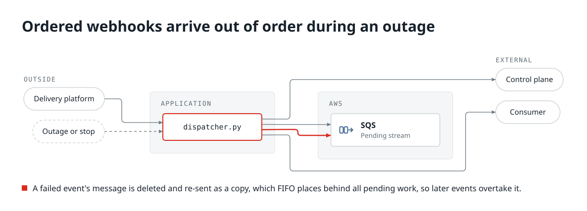

# Ordered webhooks arrive out of order during an outage

A webhook dispatcher reading an SQS FIFO queue sends batches in parallel and moves rejected events to the back of the queue, so later events overtake them.

## The system
A delivery platform promises strict order per destination. Each destination run has one SQS FIFO queue with every event in one message group, and that queue is the only record of undelivered work. `dispatcher.py` receives events, posts them to the consumer's endpoint and reports each step to a control plane, which may hold a call for tens of seconds. The platform can replace the process at any moment.

## What goes wrong
- A consumer's endpoint returned 503 for about 90 seconds. Their log shows `evt-2f9c-0003` to `0008` acknowledged, then `0002` after recovery.
- Another consumer with no failures saw `evt-6b31-0009` before `evt-6b31-0008`.

## Where the issue is
In `dispatcher.py`, `_fan_out` sends every received message on its own thread, which reorders even healthy batches and breaks the one-delivery-in-flight rule. `_finish` deletes each message first, and for a failed delivery `_requeue_for_retry` sends a copy with a new deduplication id. A FIFO queue puts that copy behind everything pending, and the original record is gone. The main loop also announces completion on any empty receive, though a stopped process's messages may still be invisible. The right shape leaves a rejected head on the queue under its original identity and retries it before anything else.

## What a correct fix must do
- Keep one delivery in flight, in order, with the head blocking everything behind it.
- Never send an acknowledged event again, even if its receipt handle expired while the control plane held a report.
- Never announce completion while a stopped process's message is merely invisible.
- Keep every control plane announcement and never extend visibility.
- Settle the product request in `decision.json`: delivering later events past a failing head cannot coexist with this contract.

## How it is graded
The tests run the dispatcher against FIFO queues, a recording receiver and a scripted control plane. In one phase the destination rejects the head and the tests read the queue mid-outage to confirm its original message id is still there. In another, SIGKILL lands at the first rejection and a replacement starts at once, while the old receive is still invisible. A healthy run holds one success report past the visibility timeout. Receiver records then prove order and single delivery, queue settings must be unchanged, and `decision.json` must reject the request.

## Why it is hard
Fixing concurrency alone leaves the back-of-queue copy, and removing the copy leaves an empty receive that looks like completion. Holding a batch's receipts while a report is delayed means a delete can fail, and redelivering would break exactly-once acknowledgement. The product request sounds reasonable, so answering it takes observed evidence.

## Real-world basis
Modelled on a design described in a public engineering post on FIFO-ordered webhook delivery, rather than a bug report.

## Task facts

| | |
|---|---|
| Task | `swe-cloud/if-sqs-dynamodb-webhook-misordered-during-outage` |
| Type | Issue fixing |
| AWS services | SQS |
| Language | Python |
| Runtime | Local AWS-compatible emulator. No internet access. |
| Hidden tests | 5 test functions |
| Expert estimate | 4 hours |
| Agent time limit | 1 hour |
| Resources | 2 CPUs, 3 GB memory |
