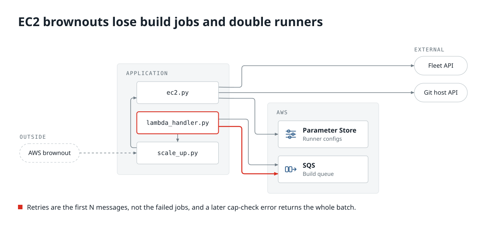

# EC2 brownouts lose build jobs and double runners

A Lambda launching EC2 runners for queued build jobs reports SQS batch failures by count, so partial failures lose jobs, double runners and strand unconfigured instances.

## The system
Queued build jobs reach an SQS queue, and an event source mapping feeds them in batches of 10 to a scale-up Lambda using `ReportBatchItemFailures`. For each job, the function launches an instance through a fleet API in front of EC2, gets a one-time runner config from a Git host, and writes it to Parameter Store for the instance to read at boot. Each owner has a runner cap. After 3 receives, messages move to a DLQ.

## What goes wrong
During a 25 minute EC2 brownout:
- Some jobs were cancelled unserved, their messages gone and not in the DLQ.
- Others got two runners, filling a cap and pushing a job into the DLQ.
- When the backlog drained, one owner ran six instances against a cap of four.
- Unconfigured instances sat idle holding cap slots.

## Where the issue is
Unlisted records are deleted, so the response must describe each job. `scale_up.py` returns the first N messages of a group, where N only counts retryable errors, so the wrong messages can be deleted or redelivered. A cap check failing for a later owner raises to `lambda_handler.py`, which returns the whole batch though earlier owners already have runners. `ec2.py` logs and forgets a failed terminate, leaving instances nobody retries. The cap check trusts `describe-runners`, which lags launches by up to 8 seconds.

The right shape tracks each message's own outcome and checks for a job's existing instance on redelivery.

## What a correct fix must do
- List a record exactly when its job has no configured runner.
- Give every job one configured runner, with none in the DLQ.
- Finish or terminate half-built instances, carrying failed terminates to the next delivery.
- Treat the cap as hard, counting recent launches from a record in Parameter Store. Setting the cap to -1 is not allowed.
- Keep the queue, timeouts and IAM role.

## How it is graded
Each scenario gets its own queue and stand-in APIs. One turns the fleet API to 503s after the first launch and throttles a `PutParameter`. Another fails a later owner's cap check. A third returns partial capacity plus a 503 from the Git host, with that instance's terminate throttled. A fourth queues more jobs right after an invocation, while its launches are still unlisted. A fifth has no API faults but throttles every Parameter Store write other than a runner config once the first runner of an invocation is configured. Every response is compared with runner state at return, then the end state must show one runner per job, no orphans, no cap breach and empty queues.

## Why it is hard
One response must settle irreversible launches. Redelivery must recognise a prior instance, yet the fleet view lags, and the record that fills that gap lives in a throttled service.

## Real-world basis
Modelled on a failure publicly reported against an open-source runner control plane.

## Task facts

| | |
|---|---|
| Task | `swe-cloud/if-sqs-lambda-runner-scaleup-partial-batch-failure` |
| Type | Issue fixing |
| AWS services | SQS, Parameter Store |
| Language | Python |
| Runtime | Local AWS-compatible emulator with live service engines. No internet access. |
| Hidden tests | 6 test functions |
| Expert estimate | 4 hours |
| Agent time limit | 1 hour |
| Resources | 4 CPUs, 8 GB memory |
