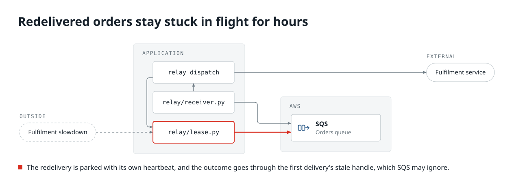

# Redelivered orders stay stuck in flight for hours

An SQS order relay parks a redelivered message while the first copy runs, then settles through the old receipt handle, so the order is never deleted or retried and its heartbeat keeps running.

## The system
`fulfilment-relay` is a long-running Python process draining the `orders` standard queue and calling a fulfilment service once per order. Each delivery gets a lease: a heartbeat that calls `ChangeMessageVisibility` on that delivery's receipt handle so the order stays hidden during slow calls. Success deletes the message, and failure makes it visible again. A redrive policy moves repeat failures to a dead-letter queue.

## What goes wrong
- Two orders never left the queue. `ApproximateNumberOfMessagesNotVisible` sat at 2 for hours, with heartbeats outliving both calls.
- One had been fulfilled but was never deleted.
- The other had failed, and was neither retried nor sent to the dead-letter queue.
- Restarting the relay brought both back, so the fulfilled order shipped twice.

## Where the issue is
When heartbeats failed, SQS redelivered orders still in progress. `relay/pending.py` avoids a second call by queueing the new delivery, but that delivery's lease keeps heartbeating. When the first call ends, the outcome goes through the first delivery's handle. Only the most recent handle is guaranteed to act, and a stale `DeleteMessage` can succeed without deleting anything. Nothing ever settles the queued lease, so it keeps renewing.

`relay/lease.py` also schedules each heartbeat 0.7 of the visibility timeout after the previous call returns, so slow answers let the lease lapse.

The right shape keeps one in-flight record per `MessageId` and applies the outcome through the newest lease, while stopping older ones.

## What a correct fix must do
- Never have two fulfilment calls open for one order.
- Delete on success, and retry on failure after `REDELIVER_VISIBILITY_TIMEOUT_SECONDS`.
- Attempt a repeatedly failing order on each receive, so it reaches the dead-letter queue only by redrive.
- Leave nothing in flight once work ends, and keep other orders flowing.
- Stay a consumer: no sending, queue changes or self-restarts.

## How it is graded
The relay runs live against SQS through a gateway that gives each delivery its own handle, ignores superseded handles as real SQS may, drops heartbeats for chosen orders, and answers extensions and releases seconds late. A stub fulfilment service holds slow calls, then succeeds or fails them, alongside poison and plain orders. Tests check queue depths, dead-letter contents, overlapping calls and retry timing.

## Why it is hard
The newest lease has to stay renewed for the whole first call, or the order redelivers repeatedly into the dead-letter queue. It must then carry the first copy's outcome. With a zero redeliver delay, the release itself can produce a new delivery before the call returns, so the in-flight record must be cleared first.

## Real-world basis
Modelled on a failure publicly reported against an open-source message bus's SQS transport, where a duplicate receive left a lock held.

## Task facts

| | |
|---|---|
| Task | `swe-cloud/if-sqs-redelivered-order-stuck-in-flight` |
| Type | Issue fixing |
| AWS services | SQS |
| Language | Python |
| Runtime | Local AWS-compatible emulator. No internet access. |
| Hidden tests | 11 test functions |
| Expert estimate | 4 hours |
| Agent time limit | 1 hour |
| Resources | 2 CPUs, 3 GB memory |
