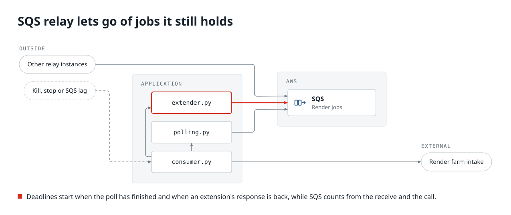

# SQS relay lets go of jobs it still holds

A relay counts each message's visibility window from when its poll finished, not from the receive, so held jobs reappear and another instance takes them.

## The system
`relay` moves render jobs from a standard SQS queue to a render farm's intake. Several instances share the queue and nothing else. Each poll sends two parallel long-poll receives for 10 messages each, and the messages form one batch, handed downstream one at a time and deleted on a 2xx. The platform fixes the visibility timeout at 20 seconds, and a single extender thread keeps held messages hidden with `ChangeMessageVisibilityBatch`.

## What goes wrong
- The farm sees the same job taken twice at once, often several jobs of one batch.
- It is worst in quiet hours, and spiked when SQS calls took 10 to 20 seconds.
- Raising the timeout to 300 seconds stopped it, but jobs of OOM-killed instances then sat for minutes.
- On SIGTERM, jobs received but not started take far longer than the timeout to reappear.

## Where the issue is
`ExtenderEntry` in `relay/extender.py` starts its deadline when the entry is created, not when SQS started the clock. An entry is created only after `Poller.call()` has waited for both receives, so in quiet hours a message can sit out the other long poll first. Likewise, `extend_deadline` counts from the moment the extension response came back, though SQS counts from the call. Either way, the next extension can land after the 20 seconds ran out.

The SIGTERM symptom is in `consumer.py`: messages behind the one in hand leave the extender only after that call returns.

## What a correct fix must do
- Date each deadline from before the receive or extension call was sent.
- Extend immediately when a batch arrives late, unless the relay is stopping.
- Never extend within the first quarter of a window, so a quick job costs no extension call.
- On SIGTERM, stop extending all but the message in hand.
- Keep 20 seconds and two receives per poll.

## How it is graded
Each case runs relay processes through an SQS proxy against a local AWS-compatible emulator, with a test downstream and a probe receiving with a zero visibility timeout. The proxy holds a poll's other receive for 17 seconds, delays a receive answer by 14 seconds, or delays an extension response by 17 seconds. Other cases SIGKILL the relay or send SIGTERM at two points. The tests read the calls and what the probe saw.

## Why it is hard
One deadline serves opposing rules. Extending late lets a held job go, extending early breaks the request budget, and a kill must still free everything within one window. The extra extension a late batch needs must not fire for a batch a stopping relay will not route.

## Real-world basis
Modelled on a failure publicly fixed in an open-source integration framework's SQS batch consumer.

## Task facts

| | |
|---|---|
| Task | `swe-cloud/if-sqs-relay-redelivers-held-messages` |
| Type | Issue fixing |
| AWS services | SQS |
| Language | Python |
| Runtime | Local AWS-compatible emulator. No internet access. |
| Hidden tests | 6 test functions |
| Expert estimate | 4 hours |
| Agent time limit | 1 hour |
| Resources | 2 CPUs, 3 GB memory |
