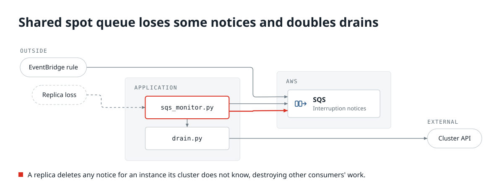

# Shared spot queue loses some notices and doubles drains

Stateless handlers from two clusters and a batch fleet share one SQS queue. One cluster deletes notices it does not own, and long drains outlast the visibility timeout, so a second replica starts.

## The system
An org-wide EventBridge rule sends every EC2 Spot Instance Interruption Warning to the SQS queue `spot-interruptions`, without telling clusters apart. Handler replicas from `prod-a` and `prod-b`, plus a batch fleet's own handler, all poll that queue. When a notice concerns one of its cluster's nodes, a replica cordons the node, evicts its pods through the cluster API, then deletes the message. Replicas share only the queue and the API, and run on spot capacity themselves.

## What goes wrong
- Two `prod-a` nodes were reclaimed with workloads running. `prod-a` never logged the notices, while `prod-b` logged `dropping interruption event for unmanaged node`.
- The batch team's handler has missed most of its notices since the same day.
- On bigger nodes, a second replica cordons and evicts during another's drain, then a cascade of 429s.

## Where the issue is
In `sqs_monitor.py`, `process_interruption_events` treats a notice for an unknown instance as not actionable and calls `DeleteMessage`. On a shared queue that destroys other consumers' work.

The doubles come from the visibility timeout. Each receive hides a message for 20 seconds, while drains take 40 to 75, so the notice reappears mid-drain. Raising the number fails too, because a dead replica's node must be picked up in time to finish.

The correct shape holds a short lease renewed with `ChangeMessageVisibility` during the drain, and hands back unwanted notices at once with visibility 0.

## What a correct fix must do
- Cordon within 10 seconds of a notice, and finish draining within 100 seconds.
- Keep one replica per node.
- Leave other consumers' notices on the queue, reachable as quickly as if this handler were absent.
- Stop holding a notice when a replica loses the cluster API, even though SQS still works.
- Delete the notice after a successful drain, without changing queue configuration.

## How it is graded
One recorded run on a local AWS-compatible emulator uses five real replicas across two clusters, a test-owned cluster API, and a batch handler. Notices are published before the owning cluster is up. One replica is killed after its second eviction on a node. Another has its API requests hang unanswered while SQS keeps working, and one lookup gets a 503. Tests read the API log and queue for timing, overlapping work, the batch notice's arrival and an empty queue.

## Why it is hard
Visibility is the only exclusion between replicas and also the only way work returns after a death, so one number pulls both ways. A heartbeat renewing regardless of progress would hold a notice hostage when the API connection dies.

## Real-world basis
Modelled on a failure publicly reported against an open-source handler for spot interruption notices on a shared queue.

## Task facts

| | |
|---|---|
| Task | `swe-cloud/if-sqs-spot-interruption-notices-lost-or-doubled` |
| Type | Issue fixing |
| AWS services | SQS |
| Language | Python |
| Runtime | Local AWS-compatible emulator. No internet access. |
| Hidden tests | 6 test functions |
| Expert estimate | 4 hours |
| Agent time limit | 1 hour |
| Resources | 2 CPUs, 3 GB memory |
