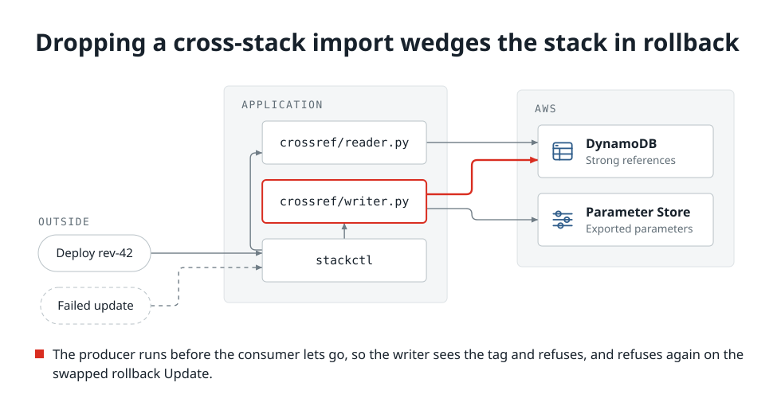

# Dropping a cross-stack import wedges the stack in rollback

Stacks share values through SSM parameters guarded by strong references. Dropping an import makes the producer's export handler refuse the deploy, and then refuse its own rollback.

## The system
A storefront runs as two CloudFormation stacks: SharedNetwork (the producer) and Storefront (the consumer). Values cross between them through custom resources rather than native exports. A writer handler publishes one SSM parameter per export, and a reader handler in the consumer resolves those parameters and records a strong-reference tag in DynamoDB, so the writer will not remove or change a value someone uses. Handlers ship inside each stack, and a local engine, `stackctl`, stands in for CloudFormation.

## What goes wrong
- Revision rev-42 swaps a security group and drops a queue and topic. Deploying the producer first fails with `Exports cannot be updated: ... is in use by stack(s) Storefront`.
- The rollback fails the same way, leaving SharedNetwork in `UPDATE_ROLLBACK_FAILED`.
- Deploying the consumer first fails too: the new parameter does not exist yet.

## Where the issue is
`crossref/writer.py` runs before the consumer has let go, so it sees the tag and refuses to remove the export. On rollback, CloudFormation sends a swapped Update, and the writer applies its "already in use" check to re-added exports, so rollback fails too. `crossref/reader.py` also removes tags inside its Update, before the consumer commits, leaving a failed consumer unprotected during rollback.

The writer never runs again for a dropped export, so it cannot delete it later. The right shape marks the export retired and lets the last holder delete it. A reader can return a new physical ID on every Update, because the cleanup Delete of the old ID arrives only after the consumer commits.

## What a correct fix must do
- Deploy dropped or swapped imports producer-first, and consumer-first then producer.
- Keep a parameter's value while any committed, in-progress or rolling-back consumer uses it, and still refuse value changes.
- Roll failed producer updates back to `UPDATE_ROLLBACK_COMPLETE`.
- Delete unused parameters by the end of the deploy, with no cleanup job.
- Take over stacks deployed by the old handlers, on the deploy that brings the new code.

## How it is graded
Tests run their own copy of the engine with fresh stacks, and probe the parameters after every handler response. Scenarios cover failed producer and consumer updates, dropping a dozen exports at once, a swap, a refused value change, and a leftover parameter. Others deploy with the old handlers first, then upgrade.

## Why it is hard
One parameter must both survive for any possible rollback and vanish by the end of the deploy, and custom resources run only when their properties change. The new code also rolls back with its stack, so old handlers may answer its cleanup Deletes and rewrite tag records it relied on.

## Real-world basis
Modelled on a failure publicly reported against an open-source infrastructure-as-code toolkit's cross-region references.

## Task facts

| | |
|---|---|
| Task | `swe-cloud/if-ssm-cfn-dropped-import-stuck-rollback` |
| Type | Issue fixing |
| AWS services | Parameter Store, DynamoDB |
| Language | Python |
| Runtime | Local AWS-compatible emulator. No internet access. |
| Hidden tests | 16 test functions |
| Expert estimate | 4 hours |
| Agent time limit | 1 hour |
| Resources | 2 CPUs, 3 GB memory |
