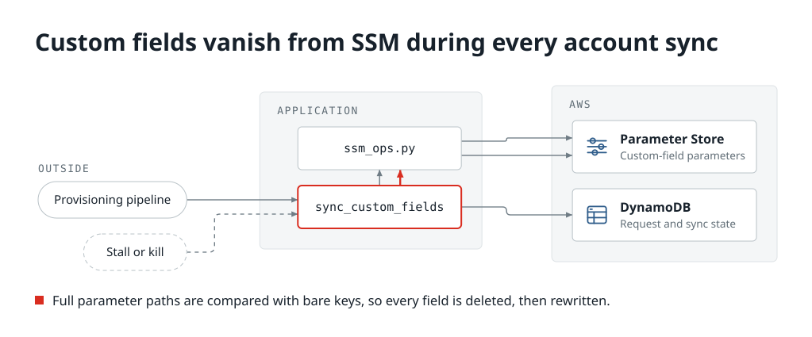

# Custom fields vanish from SSM during every account sync

An account metadata sync deletes every SSM parameter before writing it back, so live readers see fields missing. Unordered runs on stale snapshots then bring old values back or remove new ones.

## The system
A provisioning pipeline keeps an account request record in DynamoDB, with a `custom_fields` JSON map and a rising `record_version`. For each committed change it starts one sync invocation with a snapshot of the item. The sync mirrors the map into SSM Parameter Store, one String parameter per field under a shared prefix. Customizations read that prefix live with `GetParametersByPath`. A second table is reserved for the sync's own bookkeeping.

## What goes wrong
- A customization ran during a sync, could not find the field that sizes its pool, treated the pool as empty, and tore down every resource it managed.
- The field was back seconds later, so the end looked normal.
- The sync's log shows "Deleting SSM params" naming every field, for a record that removed none.

## Where the issue is
In `sync_custom_fields`, the names listed from SSM are full paths while the record's keys are bare, so the set difference selects every parameter. It also deletes before writing, leaving a gap on every field.

Fixing the comparison and the order is not enough. Invocations are unordered, overlap, carry stale snapshots, and can stall for twenty seconds or more. SSM has no multi-name transaction and no version precondition, so an old run can delete a field a newer record re-added, or overwrite a newer value. The ordering has to be built in DynamoDB: a lease per account and a recorded applied version, reading the current record rather than trusting the snapshot.

## What a correct fix must do
- Never show a kept field absent to a concurrent reader, or let its value regress.
- Remove dropped fields once a later version's sync finishes, leaving the prefix equal to the current record.
- Finish with exit 0 within 30 seconds, even around a stalled or killed run.
- Have a stale run change nothing after something newer.

## How it is graded
Each attempt runs the real CLI through a fault proxy, while a consumer polls the prefix and sizes an object pool from one field. One case holds a run's first SSM write while a newer record commits and runs. Others start an older snapshot after a newer run, kill a run mid-work and retry it, and slow every put. The tests check the reader's observations, a replay of the ordered SSM writes, and the final parameters.

## Why it is hard
One delete set decides both removal and safety. A lease must outlast a stalled request yet expire fast enough for a retry within about 20 seconds of a kill, so a fixed length fails and a live holder has to renew it.

## Real-world basis
Modelled on a failure publicly reported against an open-source AWS account provisioning framework.

## Task facts

| | |
|---|---|
| Task | `swe-cloud/if-ssm-dynamodb-custom-fields-vanish-during-sync` |
| Type | Issue fixing |
| AWS services | DynamoDB, Parameter Store |
| Language | Python |
| Runtime | Local AWS-compatible emulator. No internet access. |
| Hidden tests | 4 test functions |
| Expert estimate | 4 hours |
| Agent time limit | 1 hour |
| Resources | 2 CPUs, 3 GB memory |
