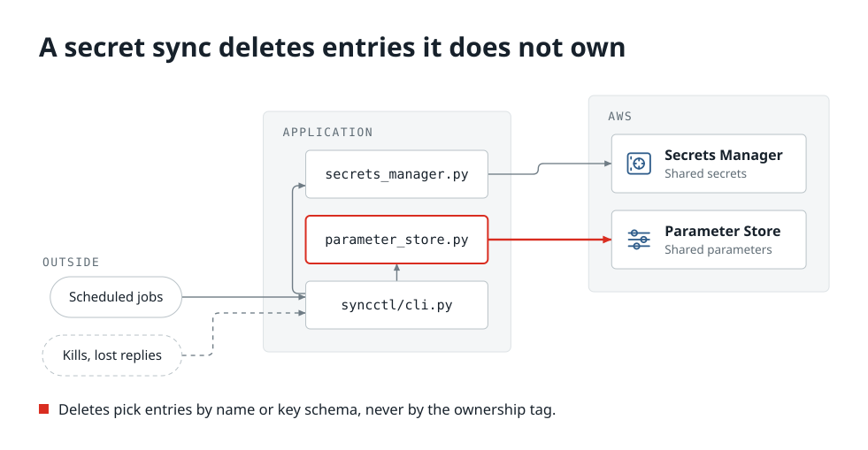

# A secret sync deletes entries it does not own

A tool pushing secrets into shared Parameter Store and Secrets Manager decides ownership by name, so it deletes other teams' entries and wipes its own at the root path.

## The system
`syncctl` pushes a key/value file into Parameter Store or Secrets Manager. Scheduled jobs run `sync` for each sync, and `remove` when one is decommissioned. Destinations are shared: path `/` holds parameters from several syncs and from ops by hand, and Secrets Manager holds everyone's secrets. The documented rule is that a sync owns exactly the entries it created, recorded as the tag `syncctl:sync-id`.

## What goes wrong
- The second `payments-root` sync at `/` deleted every parameter it had just pushed, and the next run recreated them.
- A `checkout-root` sync removed ops' hand-managed parameters at `/`.
- `syncctl remove` at `/` reported success and left its parameters behind.
- Switching `reports` to a single bundle secret force-deleted other teams' secrets, with no recovery window.

## Where the issue is
`parameter_store.py` and `secrets_manager.py` never check the ownership tag when deciding what to delete. Anything under the path or matching the key schema counts as theirs, and with no schema that means every secret in the account. At `/`, listed names keep their leading slash while desired keys do not, so nothing matches: `sync` sees its own parameters as stale, and `remove` finds nothing. `PutParameter` with `Overwrite=True` also takes over existing names. Tags go on in a follow-up call, so a kill between the two leaves an untagged entry.

## What a correct fix must do
- Set the ownership tag in the creating call, so no entry ever exists without it.
- Report a desired name held by anyone else as a conflict, even with the same value.
- Treat a secret scheduled for deletion as still holding its name.
- Delete only owned entries. A resent delete must not hit a team's new entry: re-read the owner in Parameter Store, delete by ARN in Secrets Manager.
- Judge retried writes from AWS state, not the retry's error.

## How it is graded
The tests run `syncctl` through a test proxy along fixed timelines per destination, snapshotting real state after each run. The proxy kills one run right after its second create, and later loses the first reply to each write after it was applied, so the SDK retries. Secrets are also console-deleted. Right after a sync deletes a dropped key, a team recreates that name. Snapshots must show others' entries untouched, with correct values, tags and exit codes.

## Why it is hard
One question, "is this mine?", drives both cleanup and isolation, and only tags record the answer. An untagged entry with the desired value looks like a half-finished run but must count as foreign. SDK retries also turn a successful delete dangerous once someone reuses the name.

## Real-world basis
Modelled on a failure publicly addressed in an open-source secrets platform's sync feature.

## Task facts

| | |
|---|---|
| Task | `swe-cloud/if-ssm-secretsmanager-secret-sync-deletes-shared-entries` |
| Type | Issue fixing |
| AWS services | Parameter Store, Secrets Manager |
| Language | Python |
| Runtime | Local AWS-compatible emulator. No internet access. |
| Hidden tests | 17 test functions |
| Expert estimate | 4 hours |
| Agent time limit | 1 hour |
| Resources | 2 CPUs, 3 GB memory |
