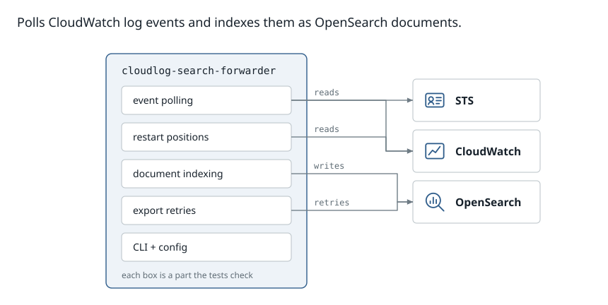

# CloudWatch log forwarder to OpenSearch

The solver rebuilds a persistent log forwarder that polls CloudWatch Logs, shapes events into documents, and delivers them to OpenSearch.

## The program
An operator runs `cloudlog-search-forwarder` to make CloudWatch logs searchable in OpenSearch. `program --config file:CONFIG.yaml` connects a log receiver to an exporter, optionally adding batching and file-based position storage. CloudWatch Logs supplies events through `FilterLogEvents`, STS supplies account identity, and the configured OpenSearch endpoint receives bulk writes. The process runs until signalled.

## What the solver gets
The solver gets a working reference build to run without reading its source, interface and configuration guides, and a local AWS-compatible emulator with an OpenSearch data endpoint. The guides describe supported components and options but leave polling and document details open. Source and `/app/build.sh` must remain under `/app`; the script builds `/app/program` offline using any installed language. Only `/app` transfers to grading.

## What must be rebuilt
- **event polling**: Select named groups and streams or discover groups by prefix and limit. Match initial lookback, explicit start times, first-poll timing, pagination, cursor advancement and treatment of late-arriving events.
- **restart positions**: Persist each group's read position when storage is enabled. Reproduce replay without storage, fresh storage directories, changed stream filters, added groups, and precedence between saved positions and start settings.
- **document indexing**: Preserve the complete event document, including body, timestamps, attributes, resource and scope. Resolve dataset and namespace defaults, index placeholders, fallbacks, time suffixes, bulk actions and ingest pipelines.
- **export retries**: Retry rejected documents after an index becomes writable, preserve accepted documents in partial failures, and honor disabled retries and maximum retry duration.
- **CLI + config**: Implement `validate`, merged configuration sources and environment expansion. Invalid component settings must fail before polling, with a diagnostic identifying the component; normal signal shutdown must complete successfully.

## How it is graded
Hidden tests create fresh log groups, streams, events, OpenSearch indices and storage directories. They start the forwarder, add events between polls, restart it with reused or fresh storage, and block then unblock index writes. Stored index names, complete document sources and multiplicities are compared with reference behavior. Event timestamps are compared as instants; observation timestamps must fall within the run. Validation failures and shutdown statuses are also checked.

## Why it is hard
The guide leaves cursor movement and restart precedence for exploration. Polling time can exclude events that arrive later with old timestamps, while retries must preserve successful writes without duplicating them. Index expansion and document metadata add independent requirements. Stream-prefix and group-pattern filtering effects are excluded because the emulator ignores them.

## Real-world basis
Modelled on an open-source telemetry collector distribution with CloudWatch Logs reception and OpenSearch export.

## Task facts

| | |
|---|---|
| Task | `swe-cloud/pc-cloudwatch-opensearch-log-forwarder` |
| Type | Program construction |
| AWS services | CloudWatch, STS, OpenSearch |
| Language | Any installed language |
| Runtime | Local AWS-compatible emulator with live service engines. No internet access. |
| Hidden tests | 40 test functions |
| Agent time limit | 4 hours |
| Resources | 4 CPUs, 8 GB memory |
