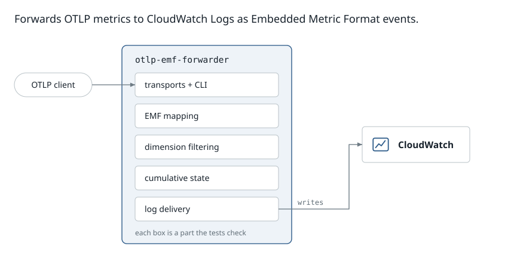

# OTLP metrics forwarder to CloudWatch Logs

The solver rebuilds an agent that receives OTLP metrics over HTTP or gRPC and writes CloudWatch Embedded Metric Format log events.

## The program
`otlp-emf-forwarder` lets application telemetry senders publish metrics through CloudWatch Logs. Operators run `program start --exporter awsemf` with listener addresses, an AWS endpoint, and destination settings. HTTP accepts protobuf or JSON at `/v1/metrics`; gRPC serves the metrics export operation. The agent batches data asynchronously and writes EMF JSON documents with CloudWatch Logs APIs. The emulator stores these events without extracting separate CloudWatch metrics.

## What the solver gets
The solver gets a working reference build to run without reading its source, interface and EMF guides, and a local AWS-compatible emulator. The guides define transports, options and output comparison, leaving mapping and state rules for exploration. Source and `/app/build.sh` must live under `/app`; the script produces `/app/program` offline using any installed language. Only `/app` transfers to grading.

## What must be rebuilt
- **transports + CLI**: Accept equivalent HTTP protobuf, HTTP JSON and gRPC requests. Support environment configuration, option precedence, invalid-option rejection and clean signal shutdown.
- **EMF mapping**: Group datapoints by their attributes, timestamps and metric types, including across resources and scopes. Match namespace derivation, unit translation, stringified attributes, duplicate names and histogram statistic sets.
- **dimension filtering**: Apply case-sensitive include and exclude wildcard patterns to dimension declarations. Keep attribute fields in the document even when excluded, and handle an empty dimension set.
- **cumulative state**: Track sums and summary changes per series, including resets and the initial-value option. Delta sums pass through, cumulative histograms are not differenced, and process restarts discard series history.
- **log delivery**: Create destination groups and streams when documents are ready, apply retention to newly created groups, and preserve existing data and retention. Recreate deleted destinations and drop unusable requests with the expected whole-request effects.

## How it is graded
Hidden tests prepare fresh or pre-existing log destinations, start the agent and send controlled metric exports through each transport. They separate exports to observe cumulative behavior, delete destinations during a run, and send unusable datapoints. Complete EMF documents, multiplicities, event timestamps, group retention and stream names are compared with reference behavior. JSON key order and metric-definition ordering are ignored, while types and missing or extra members matter.

## Why it is hard
A successful input response precedes asynchronous delivery. Grouping can merge equivalent attributes across resource boundaries, while cumulative history must remain separated by series. The guide leaves the exact mapping, reset behavior and invalid-request consequences to experiments against the reference.

## Real-world basis
Modelled on an open-source telemetry agent with OTLP receivers and a CloudWatch EMF exporter.

## Task facts

| | |
|---|---|
| Task | `swe-cloud/pc-cloudwatch-otlp-metrics-forwarder` |
| Type | Program construction |
| AWS services | CloudWatch |
| Language | Any installed language |
| Runtime | Local AWS-compatible emulator. No internet access. |
| Hidden tests | 32 test functions |
| Agent time limit | 4 hours |
| Resources | 2 CPUs, 4 GB memory |
