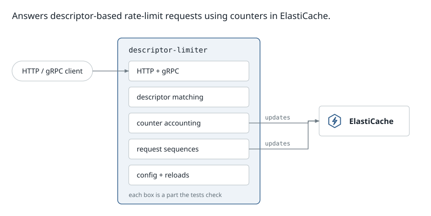

# ElastiCache descriptor rate limit service

The solver rebuilds a service that matches request descriptors against configured limits, updates ElastiCache counters, and returns HTTP or gRPC decisions.

## The program
Application gateways use `descriptor-limiter` to decide whether requests stay within fixed-window limits. Operators start `program` without arguments and configure listener addresses, runtime directories and cache endpoints through environment variables. Clients submit a domain and ordered key/value descriptors through `POST /json` or gRPC. YAML files define matching rules, while ElastiCache holds hit counters and expiries, optionally splitting per-second limits onto another deployment.

## What the solver gets
The solver gets a working reference build to run without reading its source, an interface guide, a wire-compatible message definition and a local AWS-compatible emulator. The guide describes configuration and request surfaces but leaves precedence and accounting details open. Source and `/app/build.sh` must live under `/app`; the script builds `/app/program` offline using any installed language. Only `/app` transfers to grading.

## What must be rebuilt
- **HTTP + gRPC**: Serve health checks and equivalent rate-limit operations sharing counters. Match response fields, per-descriptor ordering, reset durations, HTTP statuses, request spellings and rejected-call behavior.
- **descriptor matching**: Rank exact values, wildcard patterns and key-only rules through nested entry lists. Reproduce named replacements, unlimited rules, shadow mode and zero limits.
- **counter accounting**: Construct exact window-aligned keys and account for request or descriptor hit additions, refunds and repeated descriptors. Match remaining limits, expiry refresh, optional jitter, prefixes, storage splitting and stop-increment behavior.
- **request sequences**: Combine several descriptors into the overall decision, handle reservation/refund cycles, and share state across transports. Reloaded rules continue using existing counters, including with prefixes and split storage.
- **config + reloads**: Load the configured directory tree, validate domains and descriptors, and optionally merge domains. Reproduce invalid-configuration behavior and recovery, file-change reloads and watched-root symlink replacement.

## How it is graded
Hidden tests create fresh ElastiCache replication groups and runtime configuration trees, start the service, and send ordered HTTP and gRPC requests. They inspect exact counter keys, integer values, storage placement and expiry within a few seconds. Replies, health behavior and errors are compared with reference behavior. Tests rewrite files or swap runtime symlinks while counters remain live, and check recovery from invalid configurations.

## Why it is hard
Matching one rule is only the beginning: rule replacement, shadow decisions, refunds and repeated descriptors affect accounting differently. An over-limit request can change several counters. Configuration failures also have observable service behavior rather than a uniform startup exit, and reloads must preserve existing storage state.

## Real-world basis
Modelled on a widely used open-source descriptor-based rate-limit service for application proxies.

## Task facts

| | |
|---|---|
| Task | `swe-cloud/pc-elasticache-descriptor-rate-limiter` |
| Type | Program construction |
| AWS services | ElastiCache |
| Language | Any installed language |
| Runtime | Local AWS-compatible emulator with live service engines. No internet access. |
| Hidden tests | 39 test functions |
| Agent time limit | 4 hours |
| Resources | 4 CPUs, 8 GB memory |
