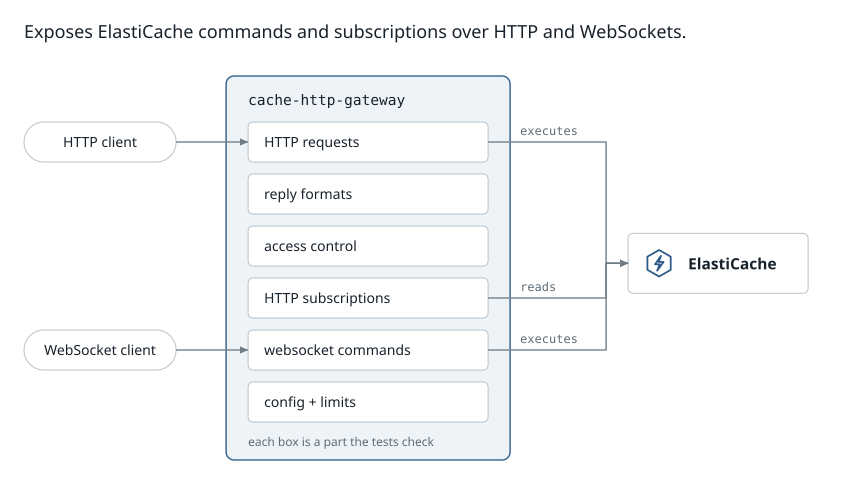

# ElastiCache HTTP and WebSocket gateway

The solver rebuilds a gateway that turns HTTP and WebSocket requests into ElastiCache commands, formats replies, and enforces access rules.

## The program
`cache-http-gateway` gives web clients access to a cache without a native cache connection. Operators run `program CONFIG.json` with HTTP listener and ElastiCache data-endpoint settings. A request such as `/SET/key/value` executes a command and returns the reply in a selected format. The foreground server also supports chunked HTTP subscriptions and WebSocket commands. ElastiCache resources are provisioned separately through the AWS API.

## What the solver gets
The solver gets a runnable reference build without readable source, an interface guide and a local AWS-compatible emulator with an ElastiCache endpoint. The guide describes requests and formats but leaves mappings, precedence and edge cases open. Source and executable `/app/build.sh` belong under `/app`; the script produces `/app/program` offline using any installed language. Only `/app` transfers to grading.

## What must be rebuilt
- **HTTP requests**: Translate GET paths, POST command bodies, PUT values and database prefixes into commands. Match escaping, empty arguments, extensions, root routing, allowed verbs, CORS, ETags and attachment headers.
- **reply formats**: Map status, error, integer, string, nil, array and special-command replies into JSON. Support JSONP, raw wire replies, MessagePack and plain values, preserving binary bytes, separators and content types where required.
- **access control**: Apply ordered command rules, IP ranges and Basic authentication, including exceptions and commands that are always refused. Denied requests must leave cache state untouched.
- **HTTP subscriptions**: Stream channel and pattern messages in order, one event per chunk, in the requested format. Apply access checks and release subscriptions when clients disconnect.
- **websocket commands**: Serve JSON and raw-protocol sockets with shared command behavior and handshake-based access checks. Handle subscriptions, large frames, ping frames, invalid JSON, masking errors and size limits.
- **config + limits**: Substitute uppercase environment references, select the default database and enforce request-size limits. Return the expected HTTP failures for unreachable storage and disabled WebSockets.

## How it is graded
Hidden tests start the gateway with fresh configurations and cache data, issue HTTP requests, and open streaming or WebSocket connections. They compare status codes, selected headers, decoded JSON and MessagePack values, exact raw bytes and stream chunk boundaries with reference behavior. Independent cache reads verify command effects and denied writes. Frame errors, oversized requests and unreachable storage exercise failure paths.

## Why it is hard
URL parsing order determines whether punctuation belongs to an argument or selects a format. Reply mappings differ by transport and format, especially for errors, nil values and nested replies. Stateful subscriptions and WebSocket framing add behavior that a simple command-to-JSON bridge cannot cover.

## Real-world basis
Modelled on an open-source HTTP and WebSocket gateway for cache command servers.

## Task facts

| | |
|---|---|
| Task | `swe-cloud/pc-elasticache-http-websocket-gateway` |
| Type | Program construction |
| AWS services | ElastiCache |
| Language | Any installed language |
| Runtime | Local AWS-compatible emulator with live service engines. No internet access. |
| Hidden tests | 63 test functions |
| Agent time limit | 4 hours |
| Resources | 4 CPUs, 8 GB memory |
