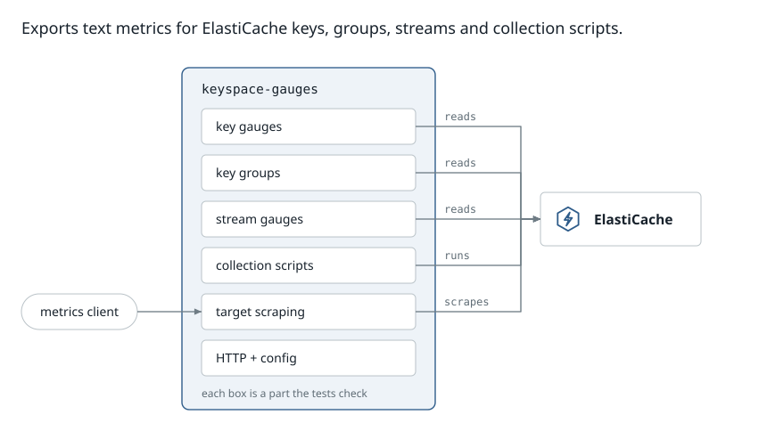

# ElastiCache keyspace metrics exporter

keyspace-gauges serves metrics about selected cache data; the solver rebuilds its collection rules, HTTP endpoints and configuration behavior.

## The program
An operator runs keyspace-gauges as a long-running HTTP service pointed at an ElastiCache endpoint. Requests to `/metrics` collect current key sizes, values, counts, stream state and script results. `/scrape?target=...` selects another endpoint. Flags choose logical databases, exact names or patterns, and a namespace for metric names.

## What the solver gets
The solver receives a working executable to run without reading its implementation, an interface guide, and a local AWS-compatible emulator for provisioning ElastiCache replication groups. The guide lists flags, metric families and comparison rules but leaves collection details open. Source and an executable `/app/build.sh` must live under `/app`; the script produces `/app/program` offline using any installed language.

## What must be rebuilt
- **key gauges**: Match type-dependent sizes, numeric versus text values, missing exact keys and pattern counts. Database prefixes, URL escapes and small scan batches affect selection.
- **key groups**: Apply ordered capture patterns across logical databases and report counts and memory. Overflow retains groups by memory with deterministic tie handling.
- **stream gauges**: Report stream, consumer-group and consumer fields, including empty streams, deleted entries and absent counters. Honor consumer-metric exclusion.
- **collection scripts**: Load script files at startup and interpret alternating names and numeric strings. Empty results, duplicate names, execution errors and read-only execution affect the reported status.
- **target scraping**: Apply query overrides for one request while preserving configured groups and scripts. Invalid requests return 400; an unreachable target produces a down gauge.
- **HTTP + config**: Reproduce help, environment precedence, startup errors, health responses and configurable telemetry paths and metric prefixes.

## How it is graded
Hidden tests populate fresh scenarios with keys of several types, streams, groups and scripts, then start the service and request collections. Parsed sample names, complete labels and values must match the reference behavior without extra series. Group memory checks require positive values and sensible relative sizes rather than exact byte counts. Tests also inspect HTTP statuses, process exits and script write effects.

## Why it is hard
The guide does not fully define numeric parsing, empty values, capture concatenation or overflow ties. Scripts can fail while key metrics remain present, and request overrides must leave later collections unchanged. Stream identifiers also need the reference's numeric representation.

## Real-world basis
Modelled on an open-source cache metrics exporter that exposes selected keyspace information over HTTP.

## Task facts

| | |
|---|---|
| Task | `swe-cloud/pc-elasticache-keyspace-metrics-exporter` |
| Type | Program construction |
| AWS services | ElastiCache |
| Language | Any installed language |
| Runtime | Local AWS-compatible emulator with live service engines. No internet access. |
| Hidden tests | 41 test functions |
| Agent time limit | 4 hours |
| Resources | 4 CPUs, 8 GB memory |
