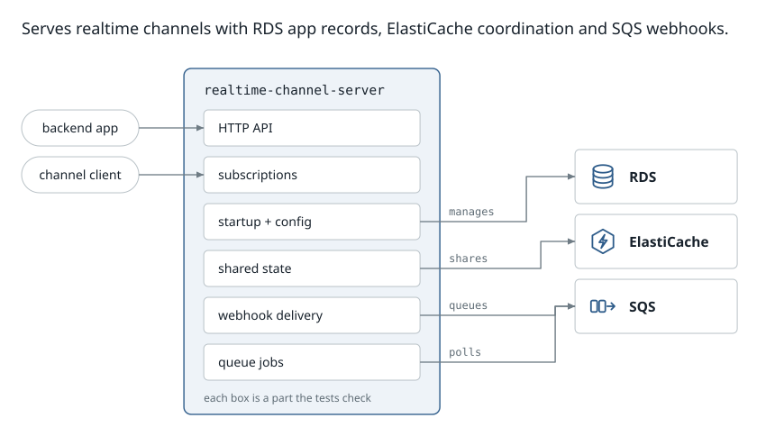

# Realtime channel server with queued webhooks

realtime-channel-server connects channel subscribers and backend publishers; the solver rebuilds its HTTP API, client sessions, shared state and webhook delivery.

## The program
Applications use this foreground server to publish events and track channel membership. WebSocket clients subscribe on the same port used by the signed HTTP API. RDS stores app credentials, limits and webhook destinations. ElastiCache coordinates servers and caches app records, while SQS holds webhook jobs for signed HTTP delivery to receivers.

## What the solver gets
The solver receives a working build to execute without reading its implementation, an interface guide and a local AWS-compatible emulator providing RDS, ElastiCache and SQS. The guide outlines requests and configuration but leaves responses and asynchronous behavior to observation. Any installed language may be used. Source and `/app/build.sh` must remain under `/app`, and the script builds `/app/program` offline.

## What must be rebuilt
- **HTTP API**: Authenticate signed publish, batch and channel-query requests. Match payload encoding, socket exclusion, app limits and error responses.
- **subscriptions**: Handle connection setup, public and authenticated private channels, presence membership, ping and unsubscribe. Enforce connection and client-event limits while relaying events to other subscribers.
- **startup + config**: Resolve TOML or JSON files and environment overrides, retaining earlier configuration on parse failure. Create or extend the RDS app table, preserve rows, answer health checks and finish pending webhooks during shutdown.
- **shared state**: Make servers sharing an adapter prefix act together, including presence and connection limits. Separate prefixes and reproduce app-cache expiry and briefly cached channel listings.
- **webhook delivery**: Generate lifecycle and client events, select targets, batch requests and sign their bodies. Retry failed deliveries with the configured backoff and confirm departures before sending vacancy events.
- **queue jobs**: Produce and consume JSON webhook jobs, including jobs from earlier servers or other producers. Handle FIFO queues, malformed messages, unknown apps and in-flight delivery retries.

## How it is graded
Hidden tests create databases, app rows, queues and webhook receivers, then start one or several servers. They compare decoded HTTP responses and ordered client frames with reference behavior, inspect the database schema and cache, and verify webhook bodies and signatures. Queue counts and delivered events are polled while receivers return selected failure statuses to exercise retries.

## Why it is hard
Presence counts users separately from connections, including across servers. Cached app changes can lag database updates. Batching, departure confirmation, retry timing and queue visibility must agree, while signed requests and client errors require exact protocol behavior.

## Real-world basis
Modelled on an open-source realtime channel server with authenticated publishing, shared presence and webhook integration.

## Task facts

| | |
|---|---|
| Task | `swe-cloud/pc-elasticache-rds-realtime-channel-server` |
| Type | Program construction |
| AWS services | RDS, ElastiCache, SQS |
| Language | Any installed language |
| Runtime | Local AWS-compatible emulator with live service engines. No internet access. |
| Hidden tests | 57 test functions |
| Agent time limit | 4 hours |
| Resources | 4 CPUs, 8 GB memory |
