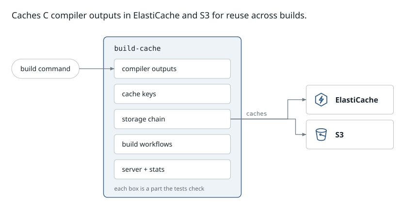

# C compiler cache with shared storage

build-cache wraps C compilation and restores reusable outputs; the solver rebuilds request classification, cache selection, ElastiCache and S3 storage, and server statistics.

## The program
A developer places build-cache before a C compiler command, such as `program cc -c source.c -o source.o`. A background server decides whether to cache the invocation. On a miss it compiles and stores the outputs; on a hit it restores files and replays captured output. Its storage chain uses ElastiCache and S3 in configurable order. `--show-stats` reports overall and per-level activity.

## What the solver gets
The solver receives a working build to execute without reading its implementation, an interface guide and a local AWS-compatible emulator for creating the cache and bucket. The guide defines configuration, entry formats and observation rules but leaves cache selection and storage interactions open. Source and `/app/build.sh` must live under `/app`. Any installed language may be used; the script builds `/app/program` offline in a fresh environment.

## What must be rebuilt
- **compiler outputs**: Preserve compiler exit status, stdout, stderr and output bytes on misses and hits. Restore companion outputs and dependency files, classify uncacheable requests, and avoid storing failed compilations.
- **cache keys**: Distinguish meaningful flags, preprocessed text, compiler identity and the cache-buster value. Reuse entries across equivalent paths, compiler aliases and output locations.
- **storage chain**: Match lookup order, writes, backfills, prefixes, logical databases and expiry. Respect read-only levels and storage-error policies, using stored ZIP members containing compressed frames for entries.
- **build workflows**: Rebuild only units affected by header edits, reuse storage from separate server processes and recover outputs when one storage level loses entries.
- **server + stats**: Support explicit and automatic startup, stop, idle timeout and statistics reset. Read storage settings at server startup and reproduce global and per-level counters in JSON and text reports.

## How it is graded
Hidden tests create fresh storage prefixes and compile small projects, then repeat builds after edits, restarts and storage changes. Output files, compiler streams and exit statuses are compared byte for byte with plain compilation or the original compile. Statistics and decoded entry contents must match reference behavior. Entry hash names may differ. Tests inspect TTLs, remove entries, make storage unavailable and wait briefly for asynchronous writes and backfills.

## Why it is hard
Input spelling and output paths can change without selecting a new entry, while meaningful preprocessing changes must invalidate it. A later-level hit backfills earlier storage, but an earlier hit need not repair later storage. Failure policy, write timing and counter resets add observable interactions.

## Real-world basis
Modelled on an open-source compiler cache with a background server and shared remote storage.

## Task facts

| | |
|---|---|
| Task | `swe-cloud/pc-elasticache-s3-compiler-cache-wrapper` |
| Type | Program construction |
| AWS services | ElastiCache, S3 |
| Language | Any installed language |
| Runtime | Local AWS-compatible emulator with live service engines. No internet access. |
| Hidden tests | 51 test functions |
| Agent time limit | 4 hours |
| Resources | 4 CPUs, 8 GB memory |
