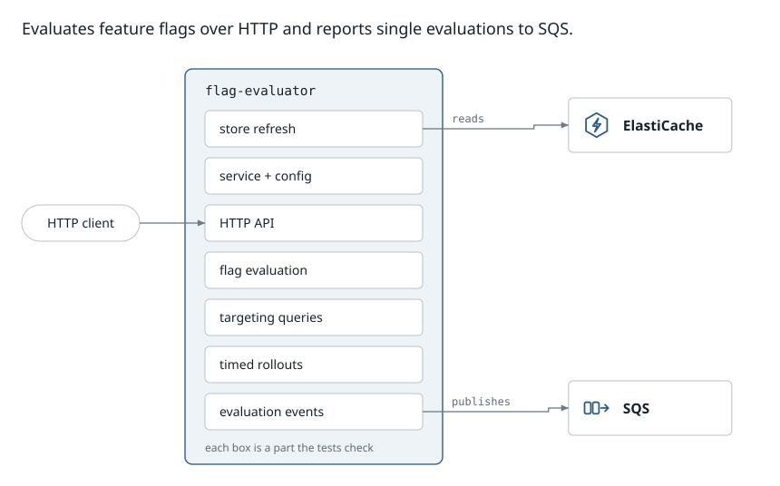

# HTTP feature flag evaluation service

Rebuild an HTTP service that evaluates flags from ElastiCache, refreshes definitions while running, and sends single-flag evaluation events to SQS.

## The program
`flag-evaluator` lets applications request flag values for a user and context. It runs in the foreground with `program --config relay.yaml`. YAML selects the HTTP port, cache database and key prefix, polling interval, and optional SQS exporter. ElastiCache holds one JSON definition per flag; SQS receives evaluation events.

## What the solver gets
The solver gets a working build to run without reading, an interface guide, and guides to definitions, HTTP endpoints and events. They describe the shapes while leaving detailed decisions open. A local AWS-compatible emulator supplies the services. Source and executable `build.sh` belong under `/app`; the script must produce `/app/program` offline using any installed language. Only `/app` transfers to grading.

## What must be rebuilt
- **store refresh**: Select and strip key prefixes, then expose additions, edits and deletions after polling. Match how unreadable JSON and invalid definitions affect a refresh.
- **service + config**: Validate YAML, handle startup store failures, answer `/health`, and exit cleanly on termination.
- **HTTP API**: Support single and bulk requests on `/ofrep/v1/evaluate/flags` and the native endpoints. Preserve response shapes, sorted bulk results, selection and context errors.
- **flag evaluation**: Preserve JSON value types, rule precedence, disabled behavior, deterministic percentage splits and bucketing errors.
- **targeting queries**: Evaluate comparisons, membership, nested attributes and boolean expressions, including missing attributes and invalid queries.
- **timed rollouts**: Apply scheduled patches, experimentation windows and progressive traffic shifts at the supplied evaluation time.
- **evaluation events**: Match event bodies, message attributes and multiplicity, including failures, anonymous contexts and suppressed events.

## How it is graded
Hidden tests start the service with fresh caches, queues and configurations, send HTTP requests, and modify stored definitions while it runs. They compare status codes, decoded response JSON, process exits and queued events with reference behavior. Invalid startup data and failed refreshes exercise error handling; event timestamps allow timing tolerance.

## Why it is hard
Similar requests can differ in reason, variant, metadata and event emission. Split rules require context that static flags may not need. A malformed stored value can affect the entire refresh, while an invalid definition can affect just one flag. These distinctions require observing the reference.

## Real-world basis
Modelled on an open-source feature flag service with remote evaluation and event export.

## Task facts

| | |
|---|---|
| Task | `swe-cloud/pc-elasticache-sqs-feature-flag-evaluator` |
| Type | Program construction |
| AWS services | ElastiCache, SQS |
| Language | Any installed language |
| Runtime | Local AWS-compatible emulator with live service engines. No internet access. |
| Hidden tests | 41 test functions |
| Agent time limit | 4 hours |
| Resources | 4 CPUs, 8 GB memory |
