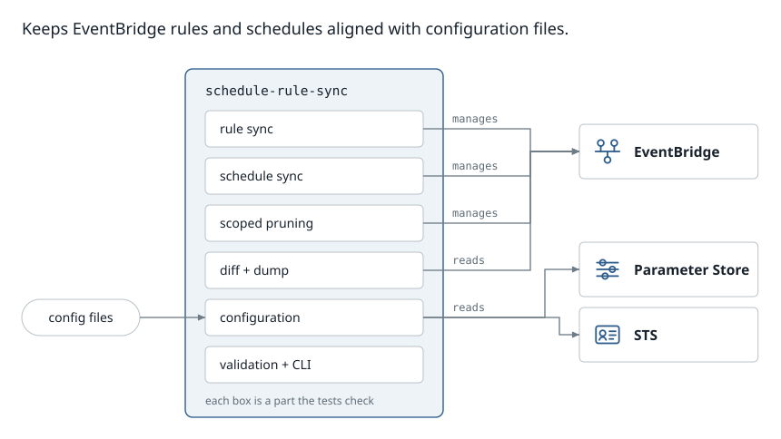

# Declarative EventBridge rules and schedules CLI

Rebuild a CLI that validates, compares, exports and applies EventBridge configuration, including targets, tags and deletion of previously managed resources.

## The program
`schedule-rule-sync` keeps event rules and time-based schedules aligned with configuration files. Operators run `program -conf CONFIG validate|dump|diff|apply`, placing flags before the subcommand. EventBridge holds rules and targets; EventBridge Scheduler holds schedules and groups. Templates can read SSM Parameter Store, and STS supplies caller identity. Configuration supports templated YAML, Jsonnet, inherited base files and file globs.

## What the solver gets
A working build is available to run without reading. Interface and configuration guides explain commands, input structure and comparison rules, leaving canonical output and synchronization details to observation. A local AWS-compatible emulator supplies the services. The solver may use any installed language, keeping source and executable `build.sh` under `/app`. It must build `/app/program` offline; only `/app` transfers.

## What must be rebuilt
- **rule sync**: Create and update rule properties, merged tags and complete target sets, including custom buses and external drift. Match no-op and dry-run behavior.
- **schedule sync**: Maintain schedules across groups, create tagged groups when needed, and handle service defaults, dates, time windows and target options.
- **scoped pruning**: Delete resources belonging to the configured tracking identity while respecting bus and group boundaries. Distinguish omitted sections from explicitly empty sections and enforce pruning guards.
- **diff + dump**: Render unified YAML diffs and export current state, honoring target, prefix and tag filters. Exported configurations must apply cleanly again.
- **configuration**: Expand environment and parameter lookups, resolve caller identity, evaluate Jsonnet and merge inherited defaults. Process files in order and report partial application failures.
- **validation + CLI**: Validate offline using lookup placeholders, report all resource problems, reject structural errors, and preserve flag placement and exit-status rules.

## How it is graded
Hidden tests write fresh configurations and parameters, prepare rules and schedule groups, and invoke each command. They compare action lines, diagnostics, exit statuses, parsed dump YAML and line-level diffs with reference results. AWS APIs reveal targets, tags and schedule fields. Tests introduce external changes and failing files, then verify corrections, partial effects and dry-run preservation.

## Why it is hard
AWS defaults and omitted fields do not always mean the same thing. Ownership tags live on individual rules but on schedule groups. Export, diff and apply need consistent normalization, while template failures and later AWS errors can leave different amounts of work completed.

## Real-world basis
Modelled on an open-source declarative configuration tool for EventBridge rules and schedules.

## Task facts

| | |
|---|---|
| Task | `swe-cloud/pc-eventbridge-schedule-config-sync-cli` |
| Type | Program construction |
| AWS services | EventBridge, Parameter Store, STS |
| Language | Any installed language |
| Runtime | Local AWS-compatible emulator. No internet access. |
| Hidden tests | 56 test functions |
| Agent time limit | 4 hours |
| Resources | 2 CPUs, 4 GB memory |
