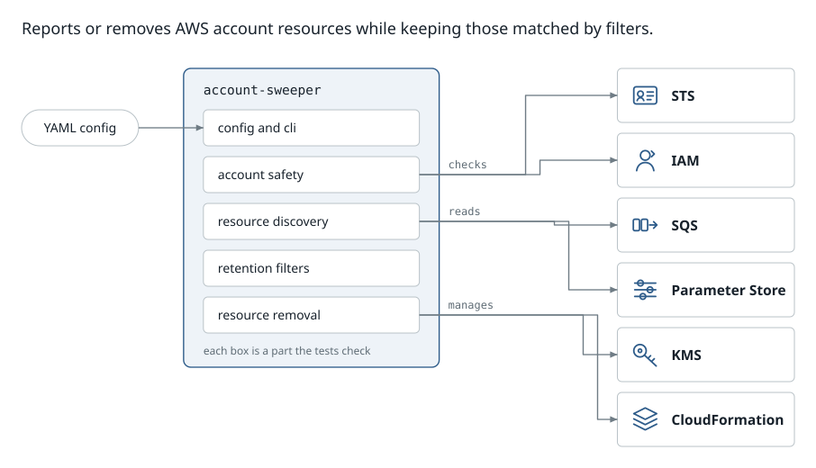

# AWS account resource cleanup CLI

account-sweeper checks account safety, keeps resources matched by YAML filters and reports or deletes the rest; the solver must rebuild those decisions and removal behavior.

## The program

An operator runs `program run --config config.yaml --default-region us-east-1 --no-prompt` to inspect an account, adding `--no-dry-run` to delete resources. STS identifies the account and IAM supplies its alias. Cleanup covers SQS, SNS, SSM, Secrets Manager, KMS, CloudWatch Logs, CloudWatch, CloudFormation and EventBridge Scheduler. YAML selects resource types and retention rules for this single region.

## What the solver gets

The solver gets an executable to run but not read, interface and configuration guides, and a local AWS-compatible emulator. The guides leave identifiers, filter interactions and removal details to exploration. Source and an executable `/app/build.sh` belong under `/app`; the script must produce `/app/program` offline using any installed language. Only `/app` transfers to verification.

## What must be rebuilt

- **config and cli**: Support command aliases, credential flags, the default configuration path and dry-run default. Quiet mode hides filtered report lines while retaining those resources.
- **account safety**: Check account membership, a nonempty blocklist, IAM aliases and blocked alias terms before discovery. Reproduce the explicitly configured alias-check bypass and leave refused accounts unchanged.
- **resource discovery**: Report the identifiers of all eleven admitted resource types, including duplicate schedule names across groups. Combine type includes and excludes, and retain AWS-managed items.
- **retention filters**: Match identifiers, properties and tags using exact, contains, glob, regex and date rules, including inversion. Combine presets and global rules, with different group logic when `filter-groups` is enabled.
- **resource removal**: Delete unfiltered resources, repeat discovery until stable and handle stack-owned resources. Reproduce KMS pending deletion, service-grant holds, protected-stack failures and settings that allow removal.

## How it is graded

Hidden tests create fresh emulator accounts, aliases, tagged resources and YAML configurations. They compare exit statuses, the multiplicity of resource identifiers and their filtered/would-remove categories against expected reference behavior, then inspect remaining AWS resources and KMS key states. Report ordering and property formatting are ignored. Protected stacks, held keys and invalid filters exercise failures; dry runs and scan failures must leave resources untouched.

## Why it is hard

A filter preserves a resource, and its identifier may differ from its name or ARN. Date comparisons, missing tags, global rules and group combinations have distinct consequences. Deletion also has several outcomes: disappearance, pending deletion, a hold or failure. Matching report categories without matching the resulting AWS state is insufficient.

## Real-world basis

Modelled on an open-source AWS account cleanup CLI that combines account safeguards with configurable resource retention.

## Task facts

| | |
|---|---|
| Task | `swe-cloud/pc-iam-account-resource-sweeper` |
| Type | Program construction |
| AWS services | STS, IAM, SQS, Parameter Store, KMS, CloudFormation |
| Language | Any installed language |
| Runtime | Local AWS-compatible emulator. No internet access. |
| Hidden tests | 34 test functions |
| Agent time limit | 4 hours |
| Resources | 2 CPUs, 4 GB memory |
