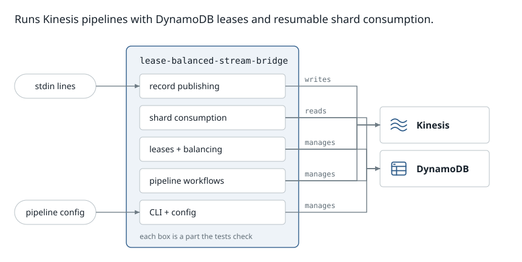

# Kinesis pipeline runner with shard leases

Rebuild a YAML pipeline runner that reads and writes Kinesis records while coordinating shard ownership and resumable checkpoints through DynamoDB.

## The program
`lease-balanced-stream-bridge` runs `program run CONFIG.yaml` until input ends or the process receives a termination signal. Operators use it to consume streams, write transformed records to files or stdout, or bridge into another Kinesis stream. A DynamoDB table stores each shard's owner, lease expiry and acknowledged sequence. A line-based stdin input can feed the Kinesis output directly.

## What the solver gets
The solver gets a working executable to run without reading, plus interface and component guides. They describe configuration fields and observation rules while leaving the lease protocol open. A local AWS-compatible emulator provides Kinesis and DynamoDB. Source and executable `/app/build.sh` must produce `/app/program` offline using any installed language. Only `/app` transfers into the fresh grading environment.

## What must be rebuilt
- **record publishing**: Send stdin messages as Kinesis records with interpolated partition and explicit hash keys. Preserve data bytes, batch completeness and per-shard order when configured for one request in flight.
- **shard consumption**: Read balanced or explicit shards, resume checkpoints, expose message metadata and honor oldest/latest settings. Advance checkpoints only through acknowledged messages, respecting batching and in-flight limits.
- **leases + balancing**: Claim and renew ownership, steal from other clients, wait through the handover period, and take over expired or crashed owners. Discover split shards and match closed-parent selection.
- **pipeline workflows**: Divide shards between two live instances, return them after shutdown, and copy records between streams. Restarts must resume from stored checkpoints without duplicating completed bridge output.
- **CLI + config**: Validate before AWS side effects, substitute environment values, keep stdout message output clean, and create the checkpoint table with the expected schema. Wait when a missing table cannot be created.

## How it is graded
Hidden tests create streams and checkpoint tables, insert records and foreign ownership rows, then run one or more processes. They compare emitted JSON lines, exact output record bytes and routing, exit statuses, and DynamoDB attribute sets and sequences with reference behavior. Lease timestamps allow timing tolerance. Tests stop or kill instances, split shards and force file-output failures to check recovery and acknowledgements.

## Why it is hard
Ownership and progress change at different times. A stolen shard needs a fresh checkpoint after the handover wait; a failed output blocks later checkpoint advancement. Crashes before the first checkpoint can behave differently from later crashes, and explicit shards follow different ownership rules from balanced streams.

## Real-world basis
Modelled on an open-source stream integration program with configurable inputs, processors and outputs.

## Task facts

| | |
|---|---|
| Task | `swe-cloud/pc-kinesis-dynamodb-stream-pipeline-runner` |
| Type | Program construction |
| AWS services | Kinesis, DynamoDB |
| Language | Any installed language |
| Runtime | Local AWS-compatible emulator. No internet access. |
| Hidden tests | 34 test functions |
| Agent time limit | 4 hours |
| Resources | 2 CPUs, 4 GB memory |
