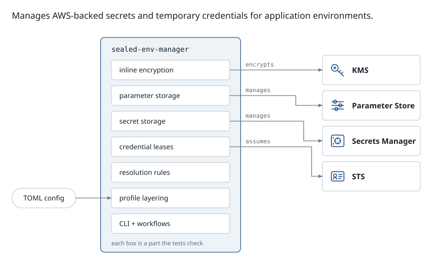

# AWS secrets and environment credential manager

The sealed-env-manager resolves AWS-backed secrets and temporary credentials into application environments; the solver rebuilds its CLI, configuration edits and stateful workflows.

## The program
Developers run `sealed-env-manager set`, `get`, `export`, `env --json` or `exec -- COMMAND` against a project TOML configuration. Values live as inline KMS ciphertext, SSM Parameter Store parameters or Secrets Manager secrets. Profiles select settings, and STS role leases supply temporary credentials to child processes. Commands also import values, re-encrypt ciphertext and remove declarations.

## What the solver gets
The solver gets a working build to run but not read, an interface guide and a local AWS-compatible emulator. The guide lists commands and config fields while leaving resolution order, file selection, batching and lease reuse to discover. Source and executable `/app/build.sh` must be under `/app`; any installed language may produce `/app/program`. Only `/app` transfers, and building and execution are offline.

## What must be rebuilt

- **inline encryption**: Use KMS to store, recover and re-encrypt inline ciphertext, respecting key aliases, provider selection, generated values and input sources. Refused writes must preserve configuration.
- **parameter storage**: Read and write SSM secure parameters with overwrite, batching and prefix rules. Support custom remote names and provider role assumption.
- **secret storage**: Read and update existing Secrets Manager values, including batch resolution, JSON paths and line selection. Reject writes to absent secrets.
- **credential leases**: Mint usable STS credentials, maintain the ledger, reuse eligible leases and revoke entries. Handle backend changes and encryption of cached credentials.
- **resolution rules**: Apply defaults, `if_missing` precedence, filters and secret references in provider fields. Distinguish missing values from invalid extraction paths.
- **profile layering**: Merge inheritance, provider overrides and profile files. Direct writes to the correct project, profile or global configuration.
- **CLI + workflows**: Match exports, environment descriptions and child behavior, including temporary files and redaction. Discover configs, import values and remove declarations while preserving comments, unrelated entries and dry-run state.

## How it is graded
Hidden tests isolate project and home directories and provision fresh KMS keys, parameters, secrets and roles. They run command sequences and compare outputs, parsed TOML edits, remote values, child environments and lease listings with reference behavior. Ciphertext is checked by decryption, and lease credentials by AWS calls. Failure cases inspect unchanged files and verify that children do not run when resolution fails.

## Why it is hard
Profiles change both read precedence and write destinations. Missing-value policy interacts with defaults, extraction failures and inherited environment variables. Lease selection depends on expiry and backend identity across separate invocations.

## Real-world basis
Modelled on an open-source developer secret manager that combines encrypted configuration, cloud providers and temporary credential leases.

## Task facts

| | |
|---|---|
| Task | `swe-cloud/pc-kms-ssm-env-credential-manager` |
| Type | Program construction |
| AWS services | KMS, Parameter Store, Secrets Manager, STS |
| Language | Any installed language |
| Runtime | Local AWS-compatible emulator. No internet access. |
| Hidden tests | 78 test functions |
| Agent time limit | 4 hours |
| Resources | 2 CPUs, 4 GB memory |
