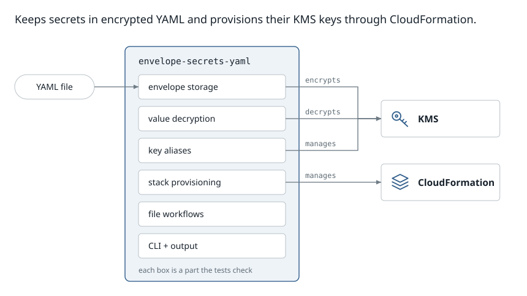

# Encrypted YAML secrets store CLI

The envelope-secrets-yaml CLI stores encrypted values in YAML and provisions KMS keys; the solver rebuilds its envelope format, commands and resource lifecycle.

## The program
Infrastructure operators run `envelope-secrets-yaml put -f FILE`, `get`, `list` and `export` to manage a local secrets file. Each value uses a fresh KMS data key for local encryption; the wrapped key is saved beside the ciphertext. `kms init -r us-east-1` provisions a labelled key through CloudFormation and records defaults in `_keys`. AWS calls use `AWS_ENDPOINT`, which differs from `AWS_ENDPOINT_URL`.

## What the solver gets
The solver gets a working build to run but not read, an interface guide and a local AWS-compatible emulator. The guide defines fields, algorithms and commands, leaving nonce layouts and interactions to investigate. Source and executable `/app/build.sh` must be under `/app`, with the script producing `/app/program` in any installed language. Only `/app` transfers; building and execution are offline.

## What must be rebuilt

- **envelope storage**: Write independently decryptable `aesgcm256` and `secretbox` envelopes with fresh data keys and nonces. Bind keys to the secret name, preserve duplicate key entries and respect template versus explicit-key selection.
- **value decryption**: Read externally constructed envelopes, route KMS calls by key region and try alternative values after failures. Preserve binary plaintext and the distinction between successful fallback and export failure status.
- **key aliases**: Reuse existing aliases, reject disabled keys and update the file's key template. Handle missing aliases and delete only the selected label's alias during destructive deprovisioning.
- **stack provisioning**: Create the expected CloudFormation stack, key description, principal parameters and optional IAM roles. Require `--destructive` for deletion and preserve unrelated resources.
- **file workflows**: Combine initialization, writes, damaged-value recovery and multiple labels in one file. Keep existing secrets and templates intact where required across updates and deprovisioning.
- **CLI + output**: Support positional flag placement, file input, environment defaults and output files. List names without `_keys`, emit exact plaintext bytes and export YAML values as strings.

## How it is graded
Hidden tests use fresh files, KMS keys and labels, and compare decoded YAML, command results and AWS state with reference behavior. They independently unwrap stored data keys using the `SecretName` encryption context and decrypt the local ciphertext. Other cases supply constructed or corrupted envelopes. Provisioning checks stack resources, parameters, aliases and IAM roles. Failed commands are checked for preserved files and absent unwanted outputs.

## Why it is hard
A template stores key references differently from encrypted values, and its algorithm can override a command flag. Decryption may recover a value while export still reports earlier failed attempts. Label provisioning must coexist with existing files and partially missing resources.

## Real-world basis
Modelled on an open-source envelope-encrypted secrets CLI for infrastructure configuration.

## Task facts

| | |
|---|---|
| Task | `swe-cloud/pc-kms-yaml-secrets-store-cli` |
| Type | Program construction |
| AWS services | KMS, CloudFormation |
| Language | Any installed language |
| Runtime | Local AWS-compatible emulator. No internet access. |
| Hidden tests | 53 test functions |
| Agent time limit | 4 hours |
| Resources | 2 CPUs, 4 GB memory |
