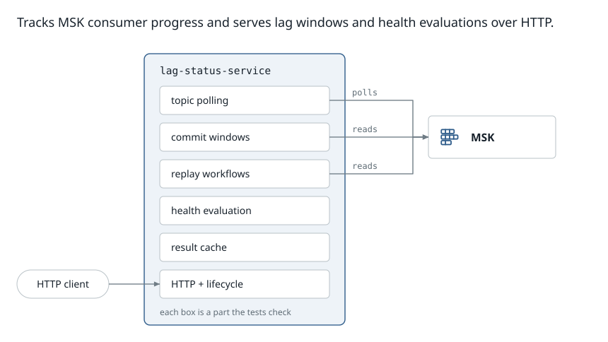

# MSK consumer lag monitoring service

The lag-status-service tracks consumer commits and broker offsets; the solver rebuilds its sliding windows, health decisions, HTTP API and process lifecycle.

## The program
Operators run `lag-status-service --config-dir DIR` with TOML settings for broker addresses, polling, storage and evaluation. The service communicates with MSK brokers, reads their internal offset-commit topic and polls partition end offsets. HTTP clients inspect topics, consumer groups, commit histories and health. Configuration routes such as `/v3/config` expose module settings, while `/v3/admin/loglevel` reads or changes logging level.

## What the solver gets
The solver gets a working build to run but not read, an interface guide, a local AWS-compatible emulator and an MSK broker. The guide gives config keys, routes and response shapes, leaving evaluation rules, window bookkeeping, replay and caching to discover. Source and executable `/app/build.sh` belong under `/app`; any installed language may produce `/app/program`. Only `/app` transfers to grading. Building and execution are offline.

## What must be rebuilt

- **topic polling**: Track topic creation, deletion and partition end offsets. Report topic consumers and remove deleted topics from stored group details while preserving the required group state.
- **commit windows**: Decode commits into bounded histories, retain null slots and merge nearby commits according to `min-distance`. Apply consumer and storage filters, expiry, group deletion and the service's own progress reporting.
- **replay workflows**: Recover historical commits at startup, implement `start-latest` and backfill, and discard expired or prematurely received commits. Recompute replayed lag against known broker offsets.
- **health evaluation**: Distinguish `OK`, `WARN`, `STOP`, `STALL` and `REWIND` partitions and aggregate group status, completeness and lag totals. Respect lag tolerance, minimum completeness and retained broker-offset history.
- **result cache**: Share cached evaluations between status and lag views until expiry. Reproduce the special handling of a cached `NOTFOUND` result when a group appears.
- **HTTP + lifecycle**: Match JSON envelopes, configuration routes, errors, CORS and log-level administration. Honor environment overrides, PID-file exclusion and clean signal shutdown.

## How it is graded
Hidden tests create an MSK cluster, topics and explicit group commits, then query HTTP while records, offsets and time advance. They compare complete JSON shapes, ordered history slots, status codes and process behavior with reference results. Name lists permit reordering, and timestamps receive plausibility checks. Scenarios include topic and group deletion, corrupted configuration, restarts, stale commits and concurrent use of a PID file.

## Why it is hard
Stored lag reflects the broker offset known when a commit is processed, while current lag changes with polling. Health depends on progress, history span and broker-offset retention rather than a fixed lag threshold. Cache expiry and read-triggered group expiry add separate timing rules.

## Real-world basis
Modelled on an open-source consumer lag monitoring service with sliding-window health evaluation and an HTTP API.

## Task facts

| | |
|---|---|
| Task | `swe-cloud/pc-msk-consumer-lag-monitor` |
| Type | Program construction |
| AWS services | MSK |
| Language | Any installed language |
| Runtime | Local AWS-compatible emulator with live service engines. No internet access. |
| Hidden tests | 39 test functions |
| Agent time limit | 4 hours |
| Resources | 4 CPUs, 8 GB memory |
