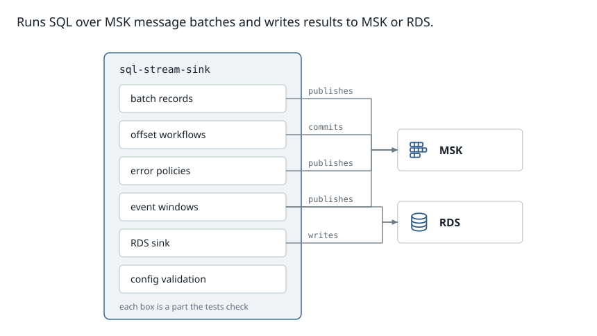

# SQL processing for message batches

Applies SQL to batches of MSK JSON records; the solver rebuilds result serialization, RDS writes, event-time windows, failure policies and configuration reports.

## The program

`sql-stream-sink` lets an operator describe a streaming SQL pipeline in YAML and launch it with `program run CONFIG`. It reads MSK messages into batches, exposes each batch as a SQL table and sends result rows to MSK, an existing RDS table, stdout or a discard sink. Optional tumbling windows accumulate partial results until event-time rules close them. A message limit supports finite runs.

## What the solver gets

The solver can run a working build but cannot read it. An interface guide explains commands and configuration, and a local AWS-compatible emulator provides MSK and RDS. Batch boundaries, commit timing and report details remain observable behavior to discover. Any installed language may be used, with source and executable `/app/build.sh` under `/app`. That script must build `/app/program` offline; only `/app` transfers to grading.

## What must be rebuilt

- **batch records**: Match memory and disk batch inference, SQL results, metadata columns, keyed output, console lines and final statistics. Flush final partial batches and commit batches that produce no rows.
- **offset workflows**: Resume existing groups, honor reset policies and commit after successful output. Drain buffered messages on signals and execute partial batches on timed flushes.
- **error policies**: Reproduce `RAISE`, `IGNORE` and `DLQ` for malformed messages and failed SQL batches, including dead-letter fields and offset consequences.
- **event windows**: Close buckets using watermarks, grace and idleness. Handle silent partitions, rejected late rows, permitted lateness and offsets held by open windows.
- **RDS sink**: Append or upsert with single or composite keys, preserving column types. Validate targets, roll back refused batches and distinguish sink failures from dead-letterable failures.
- **config validation**: Implement `validate`, `validate --json` and `config validate`, with strict schema checks, template variables, diagnostic positions, suggestions and ordered reports.

## How it is graded

Hidden tests use fresh topics, consumer groups and RDS tables. They compare decoded output records, table values, committed offsets, console rows, statistics and validation reports with reference results. Repeated runs and signals exercise recovery and draining. Malformed input, invalid SQL, unavailable sinks and database constraints expose error codes, exit statuses and rollback behavior.

## Why it is hard

Memory and disk handlers infer columns differently. Window output can remain uncommitted while a partition holds back event time, and ignored tail records need not advance progress. Validation has its own detailed contract, including distinctions between warnings, schema faults and missing template variables.

## Real-world basis

Modelled on an open-source SQL streaming pipeline runner with database and event-topic sinks.

## Task facts

| | |
|---|---|
| Task | `swe-cloud/pc-msk-rds-batch-sql-stream-processor` |
| Type | Program construction |
| AWS services | MSK, RDS |
| Language | Any installed language |
| Runtime | Local AWS-compatible emulator with live service engines. No internet access. |
| Hidden tests | 81 test functions |
| Agent time limit | 4 hours |
| Resources | 4 CPUs, 8 GB memory |
