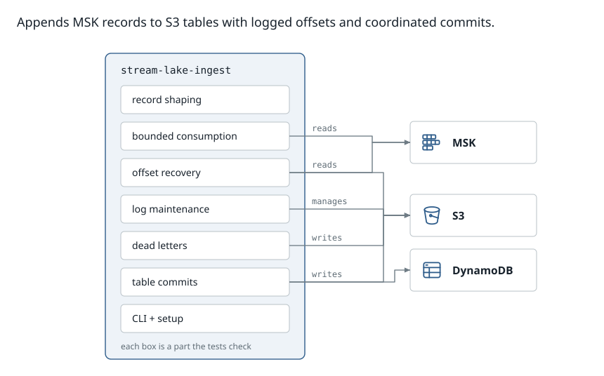

# MSK ingestion into logged S3 tables

Appends MSK JSON messages to existing S3 tables; the solver rebuilds schema conversion, coordinated commits, table-backed progress, dead letters and bounded-run behavior.

## The program

`stream-lake-ingest` serves operators loading topic data into analytical tables. `program ingest [OPTIONS] TOPIC TABLE_URI` reads MSK messages and appends columnar data files to an existing S3 table, recording files and consumed offsets in its JSON-lines transaction log. DynamoDB lock items coordinate commits. An optional second table receives failed messages, while transforms derive fields from payloads or message metadata.

## What the solver gets

The solver gets a working build to run but not read, an interface guide, a transaction-log format guide and a local AWS-compatible emulator providing MSK, S3 and DynamoDB. The guides leave actual flushing, coercion, progress and termination rules to observation. Source and executable `/app/build.sh` must live under `/app`, producing `/app/program` offline using any installed language. Only `/app` transfers into grading.

## What must be rebuilt

- **record shaping**: Evaluate field transforms and metadata expressions, coerce nested values to the table schema and preserve typed partition values, dates and timestamps.
- **bounded consumption**: Match `--ends_at_latest_offsets` across every partition, including initially empty partitions. Reproduce which buffered rows reach a commit before the run ends.
- **offset recovery**: Resume from application-specific transaction entries in the table. Match explicit seek offsets, reset policies and precedence when only some partitions have stored progress.
- **log maintenance**: Write optional checkpoints at the tenth version, resume from checkpoint-only history and pick up another writer's schema change.
- **dead letters**: Divert malformed JSON and failed transforms into the second table with the required fields and commit frequency. Match dropped failures when no dead-letter table is configured.
- **table commits**: Combine latency, batch-count and file-size triggers into the right commit sequence, file count and per-partition offsets. Write complete DynamoDB lock records with the required expiry.
- **CLI + setup**: Validate arguments, option values and table existence before writes. Honor environment settings and command-line precedence.

## How it is graded

Hidden tests create fresh topics, tables and lock tables, then publish messages before and during runs. They compare table rows and physical column types, transaction actions, file references and sizes, checkpoint contents, lock items and exit statuses with reference behavior. Later runs change application identities or offsets; a concurrent writer changes table metadata.

## Why it is hard

A full in-memory batch does not necessarily commit. Bounded completion can consume an end-offset message while leaving it uncommitted, and progress comes from table transactions rather than consumer-group commits. Nested schema conversion and concurrent metadata changes must stay consistent with that history.

## Real-world basis

Modelled on an open-source streaming ingester for transaction-log-based analytical tables in object storage.

## Task facts

| | |
|---|---|
| Task | `swe-cloud/pc-msk-s3-topic-to-table-ingester` |
| Type | Program construction |
| AWS services | MSK, S3, DynamoDB |
| Language | Any installed language |
| Runtime | Local AWS-compatible emulator with live service engines. No internet access. |
| Hidden tests | 35 test functions |
| Agent time limit | 4 hours |
| Resources | 4 CPUs, 8 GB memory |
