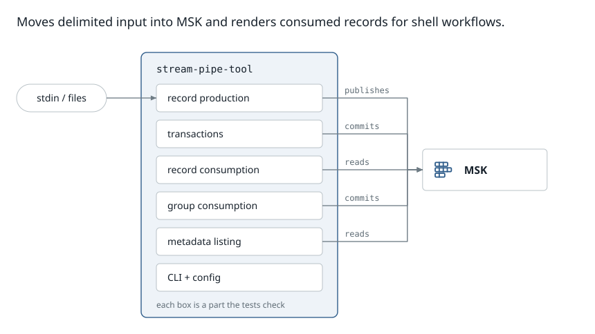

# MSK producer and consumer CLI

Moves text and binary records between shell streams and MSK; the solver rebuilds producer framing, consumer formatting, group progress, transactions and metadata listings.

## The program

`stream-pipe-tool` helps operators inspect topics and pipe application data through MSK. Run `program -P -t TOPIC` to produce stdin or file input, `-C -t TOPIC` to consume, `-G GROUP TOPIC...` to join a balanced consumer group, or `-L` to list metadata. Broker addresses come from `-b`, client properties or configuration files. Consumption supports plain text, a format-token language and JSON envelopes.

## What the solver gets

The solver receives a working build to run but not read, an interface guide and a local AWS-compatible emulator providing MSK. The guide fixes options and comparison rules but leaves framing, offset resolution, stopping conditions and committed positions for observation. Source and executable `/app/build.sh` must live under `/app` and build `/app/program` offline in any installed language. Only `/app` transfers into grading.

## What must be rebuilt

- **record production**: Split multi-byte delimiters, apply key precedence and distinguish null from empty data. Preserve ordered duplicate headers, binary payloads, whole-file versus line input, count limits, echo output and partition placement.
- **transactions**: Commit all produced records in one transaction per invocation, including repeated runs with the same identity. Empty input must create no visible records.
- **record consumption**: Render format tokens, escapes, lengths and JSON envelopes faithfully. Resolve absolute, relative, stored and timestamp offsets, count limits and end-of-partition exits across empty partitions.
- **group consumption**: Subscribe to multiple topics, honor committed positions and reset choices, and commit consumed progress. Continue waiting when no exit condition applies.
- **metadata listing**: List brokers, topics, leaders, replicas and in-sync replicas in text or JSON, optionally restricted to a topic.
- **CLI + config**: Load explicit, environment-selected and home-directory property files. Accept supported option placement and reject invalid command combinations with the required exit status.

## How it is graded

Hidden tests create fresh topics and groups, supply stdin or files, and compare stdout bytes with reference behavior. JSON envelopes and metadata are compared by decoded value. An independent client reads broker records, headers, partitions, transaction visibility and markers, and committed offsets. Tests use controlled timestamps for time windows and check output from waiting consumers before terminating them. Diagnostic stderr text is excluded.

## Why it is hard

Delimiter boundaries may cross input reads, and a missing key differs from an empty key. Formatting can include binary length prefixes, while timestamp stops and empty partitions affect termination independently of message counts. Group commits and transactional markers add state that stdout alone cannot reveal.

## Real-world basis

Modelled on an open-source command-line event-stream producer, consumer and metadata inspection utility.

## Task facts

| | |
|---|---|
| Task | `swe-cloud/pc-msk-topic-produce-consume-cli` |
| Type | Program construction |
| AWS services | MSK |
| Language | Any installed language |
| Runtime | Local AWS-compatible emulator with live service engines. No internet access. |
| Hidden tests | 61 test functions |
| Agent time limit | 4 hours |
| Resources | 4 CPUs, 8 GB memory |
