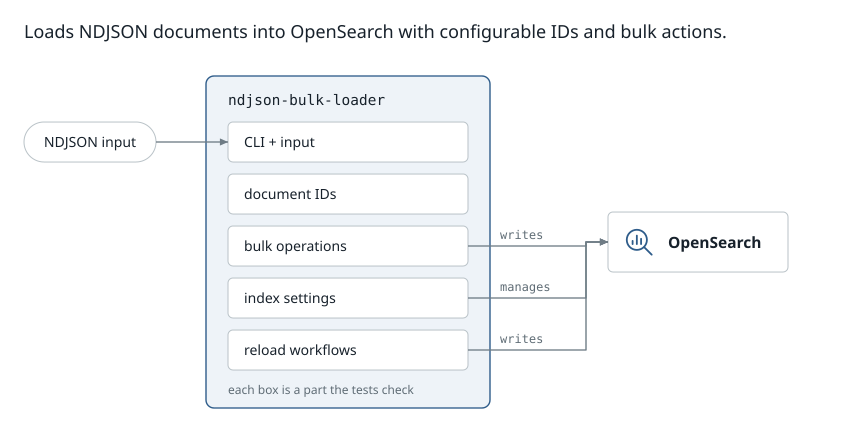

# NDJSON bulk loader for OpenSearch

Stream JSON documents into a search index, rebuilding ID extraction, bulk actions, batching failures and the index settings left after each run.

## The program
`ndjson-bulk-loader` is a CLI for operators importing newline-delimited JSON files into OpenSearch. Invoke `program -server URL -index NAME [flags] [FILE]`; omitting the file reads standard input. Parallel workers submit bulk requests. Options select IDs, write actions, mappings, creation settings and ingest pipelines, while `-purge` replaces an existing index before loading.

## What the solver gets
A working executable can be run but not read. The interface guide lists flags, input forms, endpoint setup and observation rules, leaving edge cases for experiments. A local AWS-compatible emulator supplies an Amazon OpenSearch Service domain. Source and executable `/app/build.sh` must produce `/app/program`, using any installed language. Only `/app` moves to verification, and both build and execution run offline.

## What must be rebuilt
- **CLI + input**: Validate arguments, read files or stdin, handle gzip and blank lines, and reproduce diagnostics and the treatment of an unterminated final line.
- **document IDs**: Extract nested and composite fields with exact value spellings, handle reserved ID fields, and reproduce failures for missing or unusable values.
- **bulk operations**: Implement `index`, `create` and `update`, malformed-input skipping, batch rejection, mapping/configuration loading and ingest pipelines.
- **index settings**: Adjust refresh and replica settings for loading and match final settings after successful runs, failed batches and invalid final-setting requests.
- **reload workflows**: Preserve or replace existing documents across runs, recreate mappings and settings after purge, and keep successful earlier writes when later input fails.

## How it is graded
Hidden tests create a domain and isolated indices, prepare existing documents, mappings and pipelines, then invoke the loader with files or stdin. They compare document IDs and sources, index existence, mappings, settings, exit status and output lines with reference behavior. Diagnostic timestamps are removed. Runs whose results depend on batch boundaries use one worker; other cases exercise concurrency and larger inputs. Mapping conflicts and pipeline errors provide real bulk failures.

## Why it is hard
An invalid JSON line and an unusable ID can affect different amounts of a batch. Numeric ID spelling matters even when document numbers compare by value. Final settings may still be applied after loading fails, and an invalid refresh interval can interrupt replica restoration without changing the process outcome.

## Real-world basis
Modelled on an open-source parallel bulk-import CLI for search indices.

## Task facts

| | |
|---|---|
| Task | `swe-cloud/pc-opensearch-ndjson-bulk-loader` |
| Type | Program construction |
| AWS services | OpenSearch |
| Language | Any installed language |
| Runtime | Local AWS-compatible emulator with live service engines. No internet access. |
| Hidden tests | 67 test functions |
| Agent time limit | 4 hours |
| Resources | 4 CPUs, 8 GB memory |
