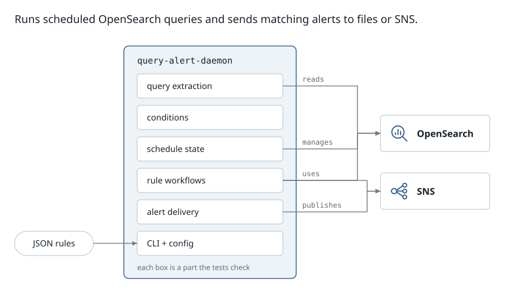

# Scheduled query alerts for OpenSearch

Run search rules on a schedule and send alerts, rebuilding response extraction, condition evaluation, output formatting and restart behavior from stored execution state.

## The program
`query-alert-daemon` helps operators watch indexed logs or other search data. Run `program` with environment variables pointing to a JSON configuration file and a directory of JSON rules. Each rule names an OpenSearch index, query, schedule, conditions and outputs. The foreground daemon appends alerts to JSON-lines files or publishes to SNS, and stores execution state in OpenSearch to resume after restart.

## What the solver gets
The solver gets a working build to execute but not read, an interface guide, and a local AWS-compatible emulator supplying a search domain and SNS topics. The guide covers formats and comparison rules while leaving response processing and scheduling details open. Source and executable `/app/build.sh` must produce `/app/program` in any installed language. Only `/app` transfers, with offline build and execution.

## What must be rebuilt
- **query extraction**: Follow paths through response arrays, summarize aggregation buckets and stringify selected objects. Preserve result ordering and numeric spelling inside body text.
- **conditions**: Apply numeric and string comparisons with `any`, `all` and `none`, including missing paths, nulls and operators applied to other value types.
- **schedule state**: Write normalized rule names, hits and next execution times; interpret interval/calendar schedules and resume from the latest matching state. Match behavior after failed state writes.
- **rule workflows**: Select rule files, evaluate realistic filtered queries and coordinate multiple rules and outputs. Renamed rules can share or lose their recorded schedule depending on normalization.
- **alert delivery**: Append file records, render SNS templates and isolate failed outputs. Match retry behavior and template errors without blocking other destinations.
- **CLI + config**: Validate every rule before scheduling, expand home-relative paths, handle flags and stop cleanly on signals.

## How it is graded
Hidden tests prepare fresh configuration directories, documents, rules, output files and topics against a domain. They start and stop the daemon, inspect state indices, read file lines and observe SNS messages through a subscribed SQS queue. Results are checked against reference behavior, including exact message text, ordered records, state contents and schedule times. Unwritable files, failed state writes and invalid templates exercise failures; log wording is ignored.

## Why it is hard
Array traversal, bucket-key chaining and body serialization interact with condition semantics. Suppression can prevent alerts while still recording an execution. Restart timing depends on normalized rule names and the latest exact state match, rather than simply starting every rule immediately.

## Real-world basis
Modelled on an open-source scheduled search-query alerting daemon.

## Task facts

| | |
|---|---|
| Task | `swe-cloud/pc-opensearch-query-alert-daemon` |
| Type | Program construction |
| AWS services | OpenSearch, SNS |
| Language | Any installed language |
| Runtime | Local AWS-compatible emulator with live service engines. No internet access. |
| Hidden tests | 46 test functions |
| Agent time limit | 4 hours |
| Resources | 4 CPUs, 8 GB memory |
