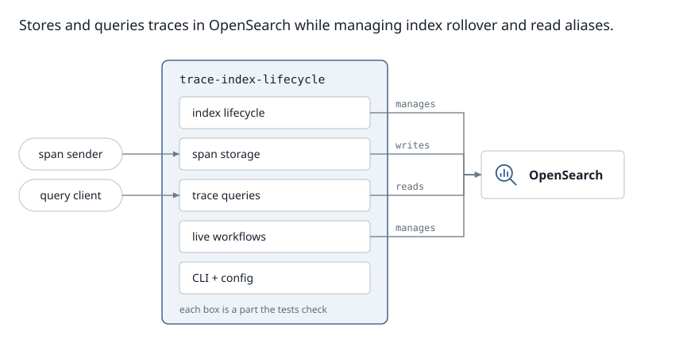

# Trace store and index lifecycle tool

Store and query distributed traces, rebuilding span conversion and search responses alongside the OpenSearch indices, templates and aliases that control rollover.

## The program
`trace-index-lifecycle` combines an operator CLI with a trace server backed by OpenSearch. Run `program es-rollover init|rollover|lookback URL` to prepare numbered index families, advance write aliases or restrict read aliases by age. Run `program --config file:PATH` to accept OTLP/HTTP JSON spans at `POST /v1/traces` and serve a JSON query API. Writes and reads follow separate aliases so ingestion can continue across generations.

## What the solver gets
A working build can be executed but not read, with an interface guide covering both invocation modes, admitted configuration and comparison rules. A local AWS-compatible emulator provides an Amazon OpenSearch Service domain. The guide leaves document conversion and lifecycle consequences for experiments. Source and executable `/app/build.sh` must produce `/app/program` in any installed language. Only `/app` transfers, and build and execution are offline.

## What must be rebuilt
- **index lifecycle**: Create templates, first-generation indices and aliases; evaluate rollover conditions and detach old generations from read aliases. Preserve write indices, idempotency and partial-failure effects.
- **span storage**: Convert typed attributes, resources, scopes, events, links and status into span documents. Store unique service/operation pairs and handle repeated spans and malformed intake.
- **trace queries**: Answer service/operation lists, current and legacy trace lookups, and searches filtered by service, attributes, duration or time. Return complete matching traces and expected error structures.
- **live workflows**: Coordinate initialization, rollover and lookback with a running server, including template changes, missing aliases and restarts that write into the current generation.
- **CLI + config**: Validate actions and options, apply environment values with flag precedence and normalize prefixes, including empty and trailing-dash cases.

## How it is graded
Hidden tests create a domain and isolated index prefixes, execute lifecycle commands, start servers and send spans. They compare aliases, templates, mappings, settings, stored documents, HTTP responses and exit statuses with reference behavior and reference-derived expectations. A transparent HTTP intermediary reports older index creation dates for lookback scenarios while forwarding real operations. Multi-step cases keep the server running as aliases move; unavailable endpoints and invalid conditions exercise failures.

## Why it is hard
Stored span documents and returned trace JSON use different representations of the same values. Read aliases determine which generations remain visible without deleting their contents. Server startup can rewrite templates, and repeated initialization does not simply restore every alias after rollover or lookback.

## Real-world basis
Modelled on a widely used open-source distributed-tracing backend with search-based storage.

## Task facts

| | |
|---|---|
| Task | `swe-cloud/pc-opensearch-trace-store-lifecycle-tool` |
| Type | Program construction |
| AWS services | OpenSearch |
| Language | Any installed language |
| Runtime | Local AWS-compatible emulator with live service engines. No internet access. |
| Hidden tests | 55 test functions |
| Agent time limit | 4 hours |
| Resources | 4 CPUs, 8 GB memory |
