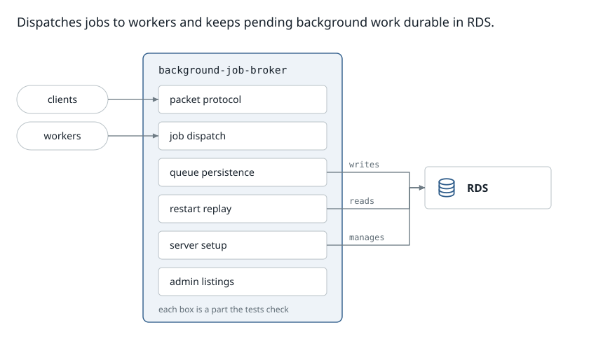

# Durable background job broker

The broker assigns named jobs to workers and stores pending background work in RDS; the solver must rebuild its TCP protocols, dispatch rules and persistence behavior.

## The program
Application clients submit work for named functions, and workers register the functions they can perform. `background-job-broker` runs as a foreground TCP server, started with `program` and queue, database and listener options. Binary packets carry submissions, assignments and results. Administrators use text commands on the same port. An RDS queue table lets unfinished background work survive a restart.

## What the solver gets
The solver gets a working executable to run but not read, interface and packet guides, and a local AWS-compatible emulator for provisioning RDS. The guides leave duplicate handling, dispatch order and row lifecycle open. Source and an executable `/app/build.sh` belong under `/app`; the script must produce `/app/program`. Any installed language may be used. Only `/app` transfers to fresh grading, where building and running happen offline.

## What must be rebuilt
- **packet protocol**: Handle framed binary requests, opaque handles, assignments, status queries and foreground progress or results. Refused requests must return the expected error codes.
- **job dispatch**: Route by worker abilities, honor priority and scheduling, rotate between functions and wake sleeping workers. Disconnects affect whether work remains available.
- **queue persistence**: Store background workloads and their priority and schedule fields. Reproduce duplicate coalescing, empty unique ids, row deletion and requeue behavior.
- **restart replay**: Reload pending and previously running work, including externally inserted rows and future scheduled jobs.
- **server setup**: Create a missing queue table, accept a compatible existing table and reject invalid credentials or layouts. Signals must shut the server down cleanly.
- **admin listings**: Implement `status` and `workers`, including queued and running counts, registered functions and client identities.

## How it is graded
Hidden tests create isolated queue tables and servers, drive binary clients and workers, send admin commands and inspect RDS rows. Expectations reflect the reference build's packets, error codes and state transitions. Workloads are compared byte for byte; table rows and admin listings are collections. Tests disconnect workers, restart servers, insert rows directly and exercise startup failures.

## Why it is hard
A submission can share an existing job without replacing its stored payload or queue position. Foreground and background clients interact with the same dispatch state, while persistence follows different rules. Scheduling and restart replay must agree with both worker assignments and database contents.

## Real-world basis
Modelled on an open-source distributed job server with a persistent database queue.

## Task facts

| | |
|---|---|
| Task | `swe-cloud/pc-rds-background-job-broker` |
| Type | Program construction |
| AWS services | RDS |
| Language | Any installed language |
| Runtime | Local AWS-compatible emulator with live service engines. No internet access. |
| Hidden tests | 48 test functions |
| Agent time limit | 4 hours |
| Resources | 4 CPUs, 8 GB memory |
