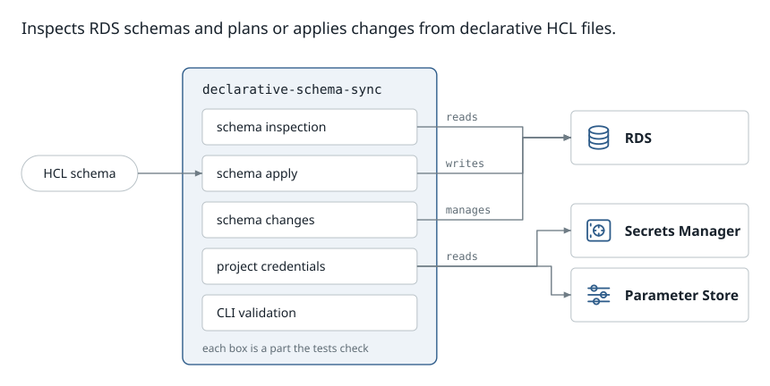

# Declarative RDS schema synchronization CLI

The CLI inspects RDS databases and plans or applies desired HCL schemas; the solver must rebuild schema normalization, SQL planning and AWS-backed project configuration.

## The program
Database maintainers use `declarative-schema-sync` to describe a desired schema in HCL instead of writing each migration. `program schema inspect` exports a live RDS schema; `schema diff` prints changes between states; `schema apply` executes a plan. A clean scratch database can normalize desired definitions before comparison. Project environments supply URLs and source files, with passwords read from Secrets Manager or Systems Manager Parameter Store.

## What the solver gets
The solver gets a working build to execute but not read, command and HCL guides, and a local AWS-compatible emulator for RDS and credential resources. The guides leave exact normalization, SQL generation and failure effects to observation. Any installed language may be used. Source and `/app/build.sh` go under `/app`, and the script must produce `/app/program`. Only `/app` transfers to fresh grading; building and running happen offline.

## What must be rebuilt
- **schema inspection**: Export HCL, SQL or JSON, including types, constraints, indexes and comments. Honor schema and exclusion filters and allow inspection output to round-trip.
- **schema apply**: Create desired schemas, tables and enum types with their dependencies. Support dry runs, repeated application and database or schema scope while leaving the scratch database clean.
- **schema changes**: Plan alterations, drift correction and dependency-aware drops. Preserve rows where appropriate and reproduce rollback or partial effects under the selected transaction mode.
- **project credentials**: Evaluate environments, variables, local expressions and combined source files. Resolve secrets and decrypted parameters where used, including rotated values and lookup failures.
- **CLI validation**: Reject invalid HCL, incompatible flags, unsupported options and unsuitable scratch databases. Refused commands must leave the target unchanged.

## How it is graded
Hidden tests prepare fresh target and scratch databases, desired-state files, secrets and parameters. They invoke the CLI and compare results with reference expectations: exit statuses, normalized SQL statements, structural HCL or JSON, and database catalogs. Catalog checks include column order, defaults, enum order, constraints and comments. Tests introduce drift, violating rows, invalid credentials and failed statements, then inspect what remains.

## Why it is hard
Equivalent definitions can differ before database normalization. Plans must combine and order dependent changes correctly, while transaction modes determine failure effects. Project evaluation must distinguish credentials needed for inspection from those needed for planning.

## Real-world basis
Modelled on an open-source declarative database schema management tool.

## Task facts

| | |
|---|---|
| Task | `swe-cloud/pc-rds-declarative-schema-sync-cli` |
| Type | Program construction |
| AWS services | RDS, Secrets Manager, Parameter Store |
| Language | Any installed language |
| Runtime | Local AWS-compatible emulator with live service engines. No internet access. |
| Hidden tests | 43 test functions |
| Agent time limit | 4 hours |
| Resources | 4 CPUs, 8 GB memory |
