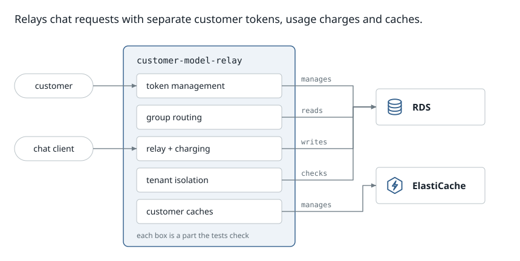

# Multi-tenant customer chat model relay

Sells model access through customer-owned tokens and group-specific upstream channels; the solver rebuilds customer and administrator management, a multi-endpoint relay, routing, isolated usage accounting, expiring caches and cache-backed rate limits.

## The program
`customer-model-relay` is a foreground HTTP server for serving several customers from shared model upstreams. Start `program --port P --log-dir D`, with environment settings for RDS records and ElastiCache entries. Customers register or use management access tokens to maintain their accounts and API tokens, then call the OpenAI-style relay endpoints with those keys. Their group determines eligible upstream channels, and the price of each request consumes customer and token quota. Administrators manage users, channels, redemption codes and logs; root manages options.

## What the solver gets
The solver gets an executable to run but not read, an interface guide and a local AWS-compatible emulator providing RDS and ElastiCache. The guide names tables, endpoints and cache keys but leaves validation, pricing and cache timing open. Source and executable `/app/build.sh` must produce `/app/program` offline using any installed language. Only `/app` transfers to grading.

## What must be rebuilt

- **token management**: Implement `/api/token/` creation, retrieval, updates and deletion, plus search and account reads. Match validation, pagination, sorting, ignored ownership fields, replacement updates and guards on re-enabling expired or exhausted tokens.
- **group routing**: Choose enabled channels serving the model in the customer's group. Match positive-priority tier selection, non-positive tiers and channel membership over repeated requests, using the channel's upstream credential.
- **relay + charging**: Forward non-streaming chat requests and return upstream completions. Check credentials, model allowlists, subnets and balances; match usage pricing, group multipliers, rounding, low-balance reservation, unlimited tokens and failures without charges.
- **tenant isolation**: Keep same-named tokens, management operations, usage logs and charges with their owner. Concurrent customers must retain exact separate totals; one customer's exhausted balance must leave another able to relay.
- **customer caches**: Store token copies and user quota, group, enabled-state and group-model entries in the configured ElastiCache database. Match contents and lifetimes, quota reservations, and recognize revocations or account changes after expiry.
- **rate limits**: Keep per-client request histories in ElastiCache lists for the general API limit and the stricter registration/login limit, refusing with 429 once full.
- **more relay endpoints**: Completions, embeddings, moderations, image generation and speech with their own pricing, streamed chat charged from the final usage event, model listing per group or token allowlist, and unimplemented routes.
- **accounts and sessions**: Registration with defaults and inviters, password login sessions, logout, profile and password changes, access-token rotation and self-deletion.
- **administration**: User search, creation, updates and role-guarded manage actions; channel create/update/delete with abilities and channel tests; redemption codes and top-ups; all-user logs and stats; root-only options that change pricing, status and registration at once.

## How it is graded
Hidden tests start the server (plus a second, rate-limited instance) with fresh RDS and ElastiCache resources, provision customers, administrators and channels through SQL, and drive customer, administrator and relay HTTP calls. They compare response fields, SQL records, usage logs, upstream requests and cache entries with reference behavior. Tests inject upstream HTTP failures, attempt cross-customer operations, run concurrent requests and inspect behavior after cache expiry. Counters are polled to allow asynchronous updates.

## Why it is hard
Management credentials and relay keys serve different roles. Quota reservation depends on the customer's balance, while final charges use upstream token counts. Database records and expiring copies must agree closely enough to preserve ownership and enforce later revocations.

## Real-world basis
Modelled on an open-source model API relay that manages customer keys, upstream channels and usage quotas.

## Task facts

| | |
|---|---|
| Task | `swe-cloud/pc-rds-elasticache-customer-model-relay` |
| Type | Program construction |
| AWS services | RDS, ElastiCache |
| Language | Any installed language |
| Runtime | Local AWS-compatible emulator with live service engines. No internet access. |
| Hidden tests | 151 test functions |
| Agent time limit | 4 hours |
| Resources | 4 CPUs, 8 GB memory |
