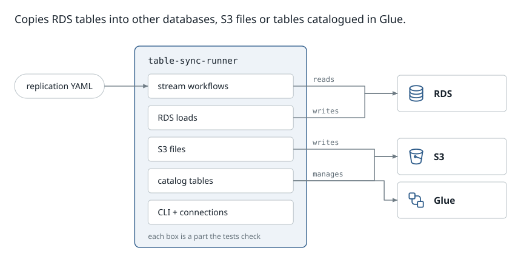

# RDS extract and load runner

The runner copies RDS tables or query results to databases, S3 files or Glue catalog tables; the solver must rebuild stream selection, loading modes and stored results.

## The program
Data engineers use `table-sync-runner` to move selected database data into another RDS database, CSV or JSON-lines files in S3, or tables registered in Glue with data and metadata in S3. `program run -r replication.yaml` executes configured streams. Single-stream flags offer the same source, target and mode controls. Named connections come from environment variables or a local YAML file. Incremental progress is read from the existing target rather than local state files.

## What the solver gets
The solver receives a working build to execute but not read, interface and replication-file guides, and a local AWS-compatible emulator for RDS, S3 and Glue. The guides leave type mappings, mode effects and file layout to observation. Any installed language is allowed. Source and `/app/build.sh` must be under `/app`; the script produces `/app/program`. Only `/app` transfers to fresh grading, where building and execution happen offline.

## What must be rebuilt
- **stream workflows**: Merge defaults and overrides, expand source-table wildcards and substitute object-name templates. Match stream selection, casing and validation across repeated runs and different targets.
- **RDS loads**: Reproduce full refresh, truncate, incremental append or merge, and stamped snapshots. Map types, preserve duplicates where required, evolve columns and derive progress from target values.
- **S3 files**: Render CSV and JSON-lines values, headers, delimiters and compression. Match object names, splitting, replacement of stale files and the behavior of empty results or unsupported modes.
- **catalog tables**: Register Glue tables and write readable data and metadata in S3. Match logical rows, schema types, refresh and incremental behavior, and whether successful or failed runs commit new metadata.
- **CLI + connections**: Support single-stream flags, connection definitions, reachability checks and selected or disabled streams. Reject invalid invocations and reproduce whether later streams run after a failure.

## How it is graded
Hidden tests create fresh source and target databases, buckets and Glue namespaces, then execute repeated loads while modifying source rows and columns. They compare reference behavior through exit status, database types and rows, Glue registrations and current logical table contents. S3 checks cover complete key sets, decoded CSV or JSON-lines values and per-file row counts. Refused runs and incompatible shapes must leave the expected target state.

## Why it is hard
The same mode behaves differently across target kinds. Incremental boundaries, schema changes and type conversion interact, while file replacement and catalog commits have distinct failure effects. Matching rows alone does not establish correct output names or no-change behavior.

## Real-world basis
Modelled on an open-source data extraction and replication CLI.

## Task facts

| | |
|---|---|
| Task | `swe-cloud/pc-rds-glue-extract-load-runner` |
| Type | Program construction |
| AWS services | RDS, S3, Glue |
| Language | Any installed language |
| Runtime | Local AWS-compatible emulator with live service engines. No internet access. |
| Hidden tests | 58 test functions |
| Agent time limit | 4 hours |
| Resources | 4 CPUs, 8 GB memory |
