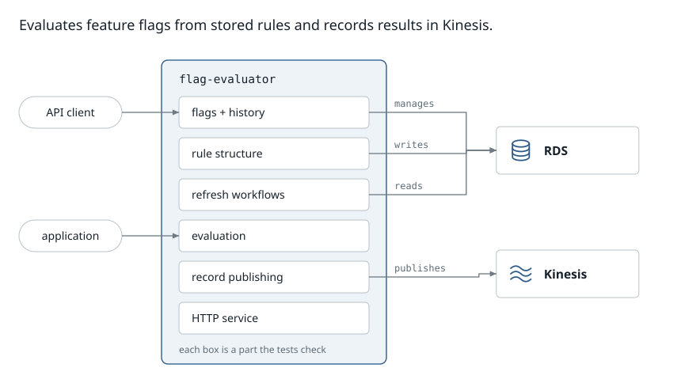

# Feature flag evaluator with record publishing

Evaluates feature flags for application entities; the solver rebuilds the HTTP server, stored flag resources, cached evaluation rules, and Kinesis record output.

## The program
`flag-evaluator` lets application teams manage experiments and request a variant for an entity. It runs as `program [OPTIONS]`, with environment configuration and `--host` and `--port` listener options. RDS holds flags and their rules; Kinesis receives evaluation records when recording is enabled globally and for the flag. JSON endpoints live under `/api/v1`.

## What the solver gets
The solver gets a working build to execute as a black box, an interface guide, an API schema, record-format documentation, and a local AWS-compatible emulator. The guides leave assignment and mutation details open. Source and an executable `/app/build.sh` must live under `/app` and produce `/app/program`. Any installed language is allowed; the build and program run offline, and only `/app` transfers.

## What must be rebuilt
- **flags + history**: Create, filter, update, duplicate, soft-delete, and restore flags. Preserve stored rows and the snapshots written by successful changes.
- **rule structure**: Manage variants, ranked segments, constraints, distributions, and tags, including validation failures and their effects on related rows.
- **refresh workflows**: Make management edits visible through periodic evaluation refreshes. Match lifecycle changes, duplication, and recording toggles across successive requests.
- **evaluation**: Match constraint operators, nested context values, ranked matching, percentage assignments, blank results, debug structure, batch selection, and GET request forms.
- **record publishing**: Emit eligible results with the correct partition keys and JSON frame mode. Respect aggregation count and size limits, including plain oversized records.
- **HTTP service**: Match help and option failures, health and generic routes, listener precedence, and persisted state after restart.

## How it is graded
Hidden tests start instances with fresh databases and streams, drive management and evaluation requests, and inspect JSON responses, HTTP statuses, database rows, and record publishing read through `GetRecords`. They also restart the server, vary recording settings, and wait across refresh and flush intervals. Results must match the reference build under the documented equivalence rules.

## Why it is hard
The API schema does not determine bucketing, fall-through on unevaluable constraints, mutation history, or ordering. Cache refresh separates stored edits from visible decisions. Record framing and aggregation add another observable result beyond a correct HTTP answer.

## Real-world basis
Modelled on an open-source feature-flag and experimentation server with persistent rules and evaluation recording.

## Task facts

| | |
|---|---|
| Task | `swe-cloud/pc-rds-kinesis-feature-flag-evaluator` |
| Type | Program construction |
| AWS services | RDS, Kinesis |
| Language | Any installed language |
| Runtime | Local AWS-compatible emulator with live service engines. No internet access. |
| Hidden tests | 51 test functions |
| Agent time limit | 4 hours |
| Resources | 4 CPUs, 8 GB memory |
