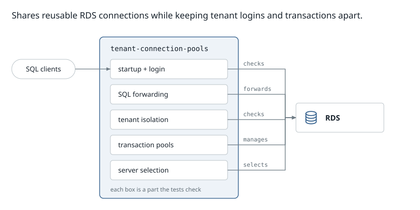

# Multi-tenant RDS transaction connection pooler

Shares reusable RDS connections across SQL clients while separating tenant credentials, databases and capacity; the solver rebuilds login, forwarding, pooling, server selection, sharding, the admin console and lifecycle handling.

## The program
`tenant-connection-pools` is a foreground database connection pooler for applications serving several tenants. Run `program [OPTIONS] [CONFIG_FILE]` with TOML describing pool aliases, frontend users, backend roles, physical databases and server lists. Clients select a tenant pool through their database name and username. The pooler forwards SQL to RDS and lends a server connection for one transaction or standalone statement.

## What the solver gets
The solver gets a working executable to run but not read, an interface guide and a local AWS-compatible emulator providing RDS. The guide defines configuration and the admitted wire protocol, leaving refusal details and pooling behavior to experiments. Source and executable `/app/build.sh` must produce `/app/program` offline using any installed language; only `/app` transfers to grading.

## What must be rebuilt

- **startup + login**: Accept configuration from arguments, environment or the working directory, plus logging flags. Match configuration exit statuses, password challenges, fresh connection metadata and refusal timing for unknown pools or wrong passwords.
- **SQL forwarding**: Deliver every result set, column name, command tag, notice and server error. Preserve transaction status through failed statements, rollback and multi-statement queries, including large results.
- **tenant isolation**: Keep the same frontend username bound to different passwords, backend roles and databases in different pools. Interleaved and concurrent transactions must stay with their tenant, and an exhausted pool must leave another tenant responsive.
- **transaction pools**: Reuse bounded server connections per pool/user and server. Pin transactions, queue or time out waiting clients, roll back disconnected clients and reset settings before reuse.
- **server selection**: Spread transactions over eligible primary and replica servers within a tenant's shard. Honor `default_role`, keep each transaction on one server and apply pool size separately to each server.
- **routing and sharding**: Answer the pooler's own server-role, primary-reads and shard commands, split reads and writes between primary and replica RDS instances, and route queries to shard databases by shard number, sharding key, query comments or `default_shard`.
- **admin console**: Serve the admin database's SHOW listings, PAUSE/RESUME, BAN/UNBAN, RELOAD and SHUTDOWN, and report unreachable servers as banned.
- **protocol and lifecycle**: Forward the extended protocol and prepared statements, cancel requests and client TLS; run session pools, idle, statement and lifetime timeouts, configuration reload by signal or timer, graceful shutdown and configuration validation.

## How it is graded
Hidden tests create tenant and shard databases, roles and marker and ledger tables on two RDS instances. Database clients and raw protocol sockets check responses against reference behavior; direct SQL inspects rows and backend session counts, roles, databases and states, and PostgreSQL's hash partitioning serves as the oracle for sharding keys. Tests hold transactions open, saturate and pause pools, cancel queries, rewrite and reload the configuration, signal the program and point servers at dead addresses. Server distribution is checked over repeated transactions, with timing tolerances for waits, timeouts and tenant independence.

## Why it is hard
Forwarding bytes is only part of the behavior. Connection ownership follows transaction state, timeout errors can leave a client usable, and session settings must be cleared without disturbing an active transaction. Capacity and server selection must remain specific to the tenant and user. Routing needs a query classifier and PostgreSQL's hash function, and the admin console, reload and shutdown paths must keep live clients consistent.

## Real-world basis
Modelled on an open-source database connection pooler with transaction pooling and backend load balancing.

## Task facts

| | |
|---|---|
| Task | `swe-cloud/pc-rds-multitenant-connection-pools` |
| Type | Program construction |
| AWS services | RDS |
| Language | Any installed language |
| Runtime | Local AWS-compatible emulator with live service engines. No internet access. |
| Hidden tests | 159 test functions |
| Agent time limit | 4 hours |
| Resources | 4 CPUs, 8 GB memory |
