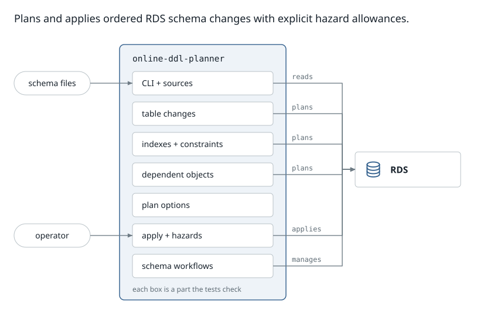

# Online schema migration planner for RDS

Compares live or file-based schemas and plans low-lock changes; the solver rebuilds ordered DDL, timeout and hazard annotations, guarded application, and schema dumps.

## The program
`online-ddl-planner` helps database operators review and apply schema changes. Its `plan` command compares RDS connection strings or directories of SQL files; `diff` is an alias. `apply` executes permitted changes, and `dump` prints schema DDL. The program connects directly to RDS databases and uses temporary databases to interpret files and rehearse plans.

## What the solver gets
The solver receives a working executable reference, an interface guide, and a local AWS-compatible emulator. The guide defines options and comparison rules but leaves operation-specific DDL and hazards open. Source and `/app/build.sh` must live under `/app`, producing `/app/program`. Any installed language may be used. Build and execution run offline; the reference, guides, and development databases do not transfer.

## What must be rebuilt
- **CLI + sources**: Resolve connection settings, recursive SQL directories, source combinations, and temporary-server selection. Match JSON and SQL serialization, failures, and temporary-database cleanup.
- **table changes**: Plan table and column changes with matching defaults, types, nullability, data packing, and follow-up analysis.
- **indexes + constraints**: Reproduce concurrent index creation and replacement, key constraints, staged validation, and foreign-key dependency ordering.
- **dependent objects**: Order sequence, enum, function, and trigger changes around their dependencies, including ownership and removal.
- **plan options**: Apply schema filters, timeout modifiers, and inserted statements at their specified positions. Reject impossible plans when validation is enabled.
- **apply + hazards**: Refuse all changes if any hazard lacks allowance. Execute accepted statements with their timeouts, preserving rows and matching effects of failures after completed steps.
- **schema workflows**: Support successive schema versions, recovery from failed validation or index creation, and executable dump round trips.

## How it is graded
Hidden tests prepare fresh databases and schema directories, invoke commands, and compare plans with the reference's normalized DDL, numeric timeouts, hazard sets, and required ordering. After application they inspect catalogs and surviving rows, final output lines, and success or failure. They deliberately cause constraint and index failures and check that temporary databases are removed.

## Why it is hard
Matching the final schema alone is insufficient: the migration steps themselves are observable. Online replacement, temporary checks, dependency order, and failure leftovers must agree with the reference. The guide does not enumerate each change's statement sequence or hazard set.

## Real-world basis
Modelled on an open-source schema comparison and online migration planner for relational databases.

## Task facts

| | |
|---|---|
| Task | `swe-cloud/pc-rds-online-ddl-migration-planner` |
| Type | Program construction |
| AWS services | RDS |
| Language | Any installed language |
| Runtime | Local AWS-compatible emulator with live service engines. No internet access. |
| Hidden tests | 75 test functions |
| Agent time limit | 4 hours |
| Resources | 4 CPUs, 8 GB memory |
