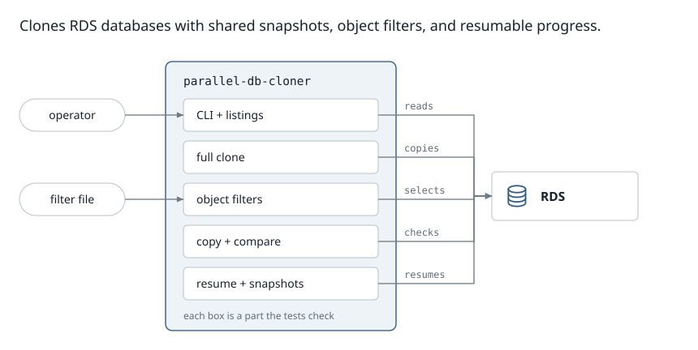

# Parallel database cloner with shared snapshots

Copies an RDS database into another using parallel workers; the solver rebuilds full and staged copying, object filters, comparison reports, and resumable work directories.

## The program
`parallel-db-cloner` serves operators moving database schema and data between RDS endpoints. Run `program clone --source ... --target ... --dir ...`, with separate table and index worker counts. It copies definitions and rows, restores sequence values, builds indexes and constraints, and copies large objects. Related `copy`, `list`, and `compare` commands expose individual steps, object selection, and source/target differences.

## What the solver gets
The solver receives a runnable reference build, interface and filter guides, and a local AWS-compatible emulator. The guides describe commands while leaving related-object selection and repeated-run details open. Any installed language is allowed. Source and `/app/build.sh` go under `/app`; the script must produce `/app/program`. Only `/app` transfers to grading, where build and execution run offline.

## What must be rebuilt
- **CLI + listings**: Resolve option and environment precedence and both connection-string forms. Match object listings, skipped-object reports, usage failures, and invalid filter handling.
- **full clone**: Reproduce schema objects, rows, sequences, indexes, constraints, and large objects across worker counts. Support skipping large objects and splitting large tables into reported parts.
- **object filters**: Interpret INI include and exclude sections consistently. Match effects on related sequences, dependencies, indexes, and tables whose data alone is excluded.
- **copy + compare**: Implement schema, data, table-data, sequence, index, and constraint steps. Report schema differences and data checksums in text or JSON.
- **resume + snapshots**: Share one source snapshot across workers. Track completed work, refuse incompatible work-directory reuse, and support `--resume`, `--restart`, and explicitly inconsistent continuation after snapshot loss.

## How it is graded
Hidden tests prepare fresh source and target databases and inspect target catalogs, row multisets, sequence state, and large objects. They compare command status and parsed listings or reports with reference behavior. Tests also introduce a target-side copy failure, modify the source before resuming, reuse completed work directories, and block a target table while new source rows are committed.

## Why it is hard
Filters affect dependencies as well as named tables. Every worker must see the same source snapshot, even when it reaches a table later. Resume must preserve completed copies while respecting expired snapshots and the work directory's original target.

## Real-world basis
Modelled on an open-source parallel relational database copying utility with staged operations and local progress tracking.

## Task facts

| | |
|---|---|
| Task | `swe-cloud/pc-rds-parallel-database-cloner` |
| Type | Program construction |
| AWS services | RDS |
| Language | Any installed language |
| Runtime | Local AWS-compatible emulator with live service engines. No internet access. |
| Hidden tests | 27 test functions |
| Agent time limit | 4 hours |
| Resources | 4 CPUs, 8 GB memory |
