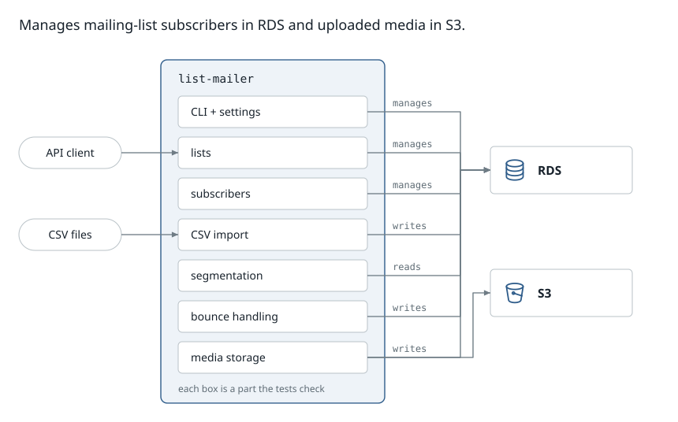

# Mailing lists with subscriber and media storage

Rebuild a mailing-list manager whose HTTP API maintains RDS subscribers, imports CSV data, processes bounces and stores uploaded media in S3.

## The program
`list-mailer` serves operators managing lists and subscriber records. `program --install --yes --config config.toml` initializes RDS storage; running with the config starts an authenticated HTTP JSON API. RDS stores memberships, settings, bounce records and media metadata, while S3 holds uploaded files and thumbnails. Mail delivery is outside the task's scope.

## What the solver gets
A working build can be run but not read, with interface, API and query-language guides and a local AWS-compatible emulator. The guides leave schema details, membership transitions and import behavior open. The solver writes source and `/app/build.sh` under `/app`, producing `/app/program` in any installed language. Only `/app` transfers, and rebuilding runs offline.

## What must be rebuilt

- **CLI + settings**: Match installation, upgrades, configuration, API credentials and sample-config creation. Persist settings by key, mask secrets, enforce domain restrictions and reload settings while preserving state across restarts.
- **lists**: Create, query, update and delete lists with the expected defaults, tags and validation. Removing a list deletes its memberships while retaining subscribers.
- **subscribers**: Normalize addresses and maintain profiles, JSON attributes and per-list statuses. Distinguish full replacement from partial updates, and support blocklisting and deletion.
- **CSV import**: Accept CSV or ZIP uploads with configurable delimiters and header handling. Match subscribe/blocklist modes, independent overwrite switches, validation and asynchronous status counts.
- **segmentation**: Evaluate SQL-expression queries, text searches and membership filters. Reproduce ordering, pagination and bulk membership, blocklist and delete actions by IDs or query.
- **bounce handling**: Gate the webhook with both required settings. Match per-type counts and actions, record validation, subscriber identification and bounce listing or deletion.
- **media storage**: Upload objects to S3 with matching keys, bytes and content types. Handle duplicate filenames, thumbnails, extension restrictions, deletion and public or presigned URLs.

## How it is graded
Hidden tests install into fresh RDS databases, start the server and drive authenticated HTTP endpoints. They compare JSON fields, database rows, import counts and S3 objects against reference behavior, checking generated identifiers through their relationships. Tests poll background imports and bounces, update settings, restart processes and force email attempts to fail quickly while checking that subscriber operations still succeed.

## Why it is hard
Subscriber-wide status and membership status are separate, and imports can overwrite each independently. Bounce thresholds and domain rules interact with later actions. Media records, object names and returned URLs must remain consistent through reloads and deletion.

## Real-world basis
Modelled on an open-source self-hosted mailing-list and subscriber management application with configurable media storage.

## Task facts

| | |
|---|---|
| Task | `swe-cloud/pc-rds-s3-mailing-list-manager` |
| Type | Program construction |
| AWS services | RDS, S3 |
| Language | Any installed language |
| Runtime | Local AWS-compatible emulator with live service engines. No internet access. |
| Hidden tests | 62 test functions |
| Agent time limit | 4 hours |
| Resources | 4 CPUs, 8 GB memory |
