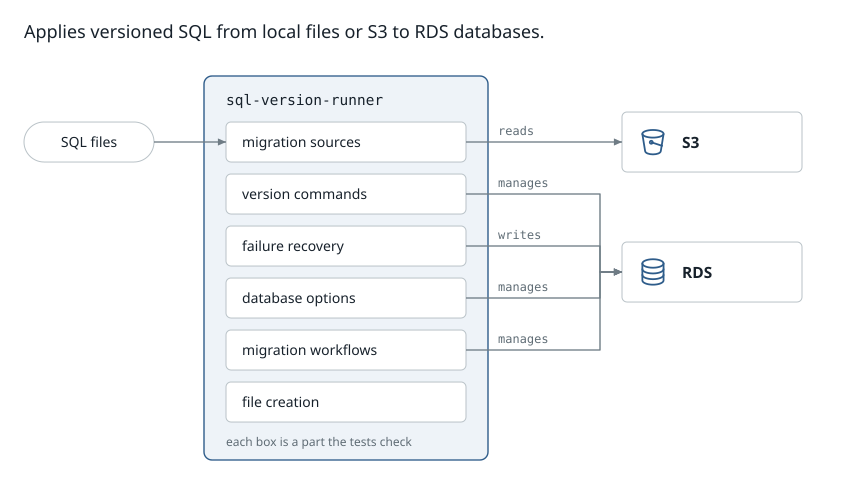

# Versioned SQL migrations from files and S3

Applies numbered SQL migrations to RDS and records their version; rebuild command behavior, source discovery, failure recovery, locking and migration file creation.

## The program
`sql-version-runner` is a deployment CLI that reads paired up/down SQL files from a local directory or S3 prefix. Operators supply `-path` or `-source` and a `-database` URL. Commands such as `up`, `down` and `goto` change the RDS database; a bookkeeping table records the current version and dirty flag. `create` generates empty migration pairs without a database.

## What the solver gets
The solver gets a working executable to run but not read, an interface guide and a local AWS-compatible emulator providing S3 and RDS. The guide defines commands and observation rules but leaves detailed version selection and failure semantics open. Any installed language is allowed. Source and executable `build.sh` must be under `/app`; the script produces `/app/program` offline. Only `/app` survives into verification.

## What must be rebuilt
- **migration sources**: Discover valid filenames, sort versions numerically and reject duplicate versions. Read direct children of S3 prefixes, including listings spanning multiple pages, without changing source objects.
- **version commands**: Match step limits, confirmation prompts, movement to a chosen version, reporting, forced versions and dropping database contents. Refused arguments must leave existing objects intact.
- **failure recovery**: Record dirty versions after failed up or down files and refuse further migrations until recovery. Match rollback boundaries and the effects of `force` and `drop` on dirty state.
- **database options**: Support custom bookkeeping tables, quoted names, statement splitting and timeouts. Keep independent histories separate within one database.
- **migration workflows**: Handle missing directions, source changes and recovery across command sequences. Serialize concurrent operations on one history while allowing independent histories to proceed.
- **file creation**: Generate empty sequential or timestamped migration pairs with the requested directory, width, format and time zone. Invalid requests and naming collisions must not leave partial files.

## How it is graded
Hidden tests use fresh databases and local directories or S3 buckets, then compare command effects with the reference build. They inspect bookkeeping rows, database tables, rows and indexes, success versus failure, `version` text on stderr, and generated file names and contents. Concurrent invocations check locking. Deliberately failing SQL checks dirty state and recovery; general diagnostic wording is not compared.

## Why it is hard
The next migration depends on available directions, numeric versions and the recorded state. Transaction boundaries, semicolon splitting, dirty target versions, custom history names and lock scope interact in ways the interface guide leaves for observation.

## Real-world basis
Modelled on an open-source database migration CLI with versioned SQL files and multiple migration sources.

## Task facts

| | |
|---|---|
| Task | `swe-cloud/pc-rds-sql-version-migration-cli` |
| Type | Program construction |
| AWS services | S3, RDS |
| Language | Any installed language |
| Runtime | Local AWS-compatible emulator with live service engines. No internet access. |
| Hidden tests | 79 test functions |
| Agent time limit | 4 hours |
| Resources | 4 CPUs, 8 GB memory |
