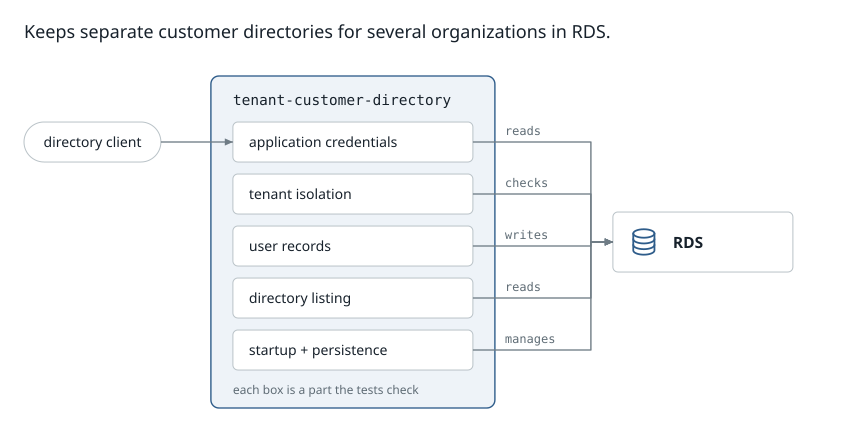

# Multi-tenant customer directory on RDS

Keeps several organizations' customer directories behind separate application credentials; the solver rebuilds the HTTP API, S3 file storage, OAuth tokens, tenant boundaries and persistent records.

## The program
`tenant-customer-directory` is an HTTP JSON server for organizations managing their own users in one RDS database. An operator starts `program -config PATH -createDatabase` with an INI-style configuration and a JSON initial-data file containing organizations, applications and optional users. Each application's `clientId` and `clientSecret` administer its organization's users, groups, roles, settings and uploaded files through `/api/` endpoints, and obtain, introspect and revoke OAuth 2.0 tokens whose signing keys are published for discovery. Uploaded files are stored in Amazon S3 buckets named by storage providers in the initial data.

## What the solver gets
The solver gets a working executable to run but not read, an interface guide and a local AWS-compatible emulator providing RDS and S3. The guide specifies endpoints, fields and tables but leaves exact responses and update rules to discovery. Source and an executable `/app/build.sh` must build `/app/program` offline in any installed language. Only `/app` transfers to grading.

## What must be rebuilt

- **application credentials**: Resolve HTTP Basic or query credentials through stored applications. Match different credential failure messages and retain rotated secrets across restarts.
- **tenant isolation**: Reject access to another organization's records despite conflicting identifier, query or body fields. Same-named users remain independent, including during concurrent updates; refused requests leave every stored row unchanged.
- **user records**: Implement `/api/get-user`, `/api/add-user`, `/api/update-user` and `/api/delete-user`. Match profile validation, full replacement versus `columns` updates, renames, immutable UUIDs, timestamps and masked password round trips.
- **directory listing**: Return only the caller's organization's users through `/api/get-users`. Match page membership, total counts, newest-first pagination and unusual page bounds.
- **organization + passwords**: Read and update the own organization, count and sort users, set passwords under the organization's password rules and storage type.
- **groups + roles**: Manage group hierarchies, memberships and roles, with refused deletions and renames that update references.
- **S3 resources**: Upload files through storage providers into S3, apply path rules, numbered repeats, path prefixes, avatars, listings and deletions of objects and records.
- **OAuth tokens**: Issue RS256 JWTs for client-credentials, password and refresh grants, introspect, revoke, count failed attempts, and publish discovery documents and JWKS.
- **startup + persistence**: Select the configuration, optionally create the database and provision initial objects. Preserve existing edits on restart while recreating missing objects listed in initial data.

## How it is graded
Hidden tests use a fresh database and server for each scenario on an RDS instance. They send HTTP requests and compare status codes, exact envelope and OAuth error messages, admitted fields, token claims and signatures, S3 objects and SQL rows with reference behavior. Two organizations share usernames; tests attempt cross-organization reads and writes, interleave concurrent updates, rotate stored credentials and restart the server. Refusal checks compare complete user-row snapshots.

## Why it is hard
Access depends on several identifiers whose roles differ by endpoint. Full updates clear omitted fields, restricted updates preserve unlisted fields, and renames retain identity. Restart provisioning can restore a deleted initial user while preserving another user's edits. These details must agree across HTTP responses and stored state.

## Real-world basis
Modelled on an open-source identity and access management server, scoped here to organization-specific customer directories.

## Task facts

| | |
|---|---|
| Task | `swe-cloud/pc-rds-tenant-customer-directory` |
| Type | Program construction |
| AWS services | RDS, S3 |
| Language | Any installed language |
| Runtime | Local AWS-compatible emulator with live service engines. No internet access. |
| Hidden tests | 131 test functions |
| Agent time limit | 4 hours |
| Resources | 4 CPUs, 8 GB memory |
