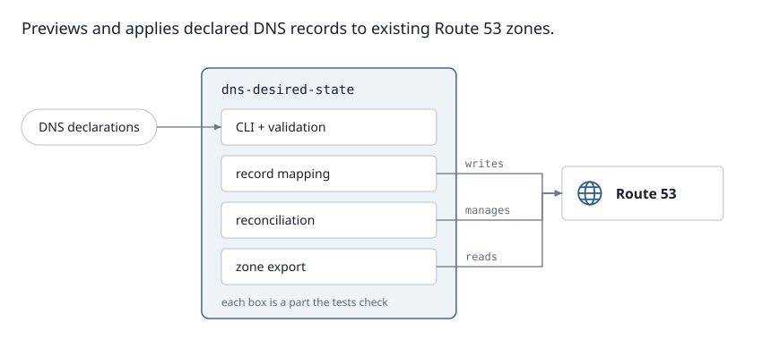

# Declarative Route 53 DNS record reconciler

Compares declared DNS records with existing Route 53 zones; rebuild configuration validation, preview and push reconciliation, correction counts and zone export formats.

## The program
`dns-desired-state` is a CLI for operators maintaining DNS as code. It reads `dnsconfig.js` declarations and named credentials from `creds.json`. `check` validates locally, `preview` reports corrections, and `push` applies them through Route 53 record-set operations. `get-zones` exports existing zones as configuration, zone-file, TSV or name-only output. Hosted zones must already exist.

## What the solver gets
The solver gets a working executable to run but not read, interface and configuration-language guides, and a local AWS-compatible emulator providing Route 53. The guides define declaration functions and comparison rules while leaving normalization, counting and reconciliation details open. Any installed language may be used. Source and executable `build.sh` belong under `/app`; the offline build must produce `/app/program`. Only `/app` transfers to verification.

## What must be rebuilt
- **CLI + validation**: Evaluate declarations, supplied variables and included files, and reject invalid configurations before changing zones. `check` must work without a provider; missing credentials, domain filters and `--expect-no-changes` need the expected outcomes.
- **record mapping**: Convert address, mail, text, service, authority and alias declarations to record sets. Match relative names, target normalization, TTL durations, text quoting and chunking, and alias target settings.
- **reconciliation**: Add, update or delete records while recognizing equivalent existing values. Respect `IGNORE` patterns and `NO_PURGE`, prevent unsafe conflicts, and reproduce how a problem in one zone affects the others.
- **zone export**: Read existing zones and emit each supported format, including the legacy invocation. Match output-file handling, all-zone selection, errors and configuration exports that can be pushed back unchanged.

## How it is graded
Hidden tests create fresh hosted zones, populate records through Route 53, and compare command results with the reference build. They inspect complete record sets, including apex nameserver and authority records, exact values, TTLs and alias fields. Preview and push output is checked for domain headers and the total correction count. Exports use format-specific comparisons; exit status is checked as success or failure. An unreachable endpoint confirms that `check` stays offline.

## Why it is hard
Several declarations become one record set, while text escaping and trailing dots affect equality. Ignoring one value within a set, switching between aliases and ordinary records, and preserving unmanaged records make correction counting and safe multi-zone updates subtle.

## Real-world basis
Modelled on an open-source DNS management CLI that evaluates executable declarations and reconciles them with provider records.

## Task facts

| | |
|---|---|
| Task | `swe-cloud/pc-route53-dns-record-reconciler` |
| Type | Program construction |
| AWS services | Route 53 |
| Language | Any installed language |
| Runtime | Local AWS-compatible emulator. No internet access. |
| Hidden tests | 29 test functions |
| Agent time limit | 4 hours |
| Resources | 2 CPUs, 4 GB memory |
