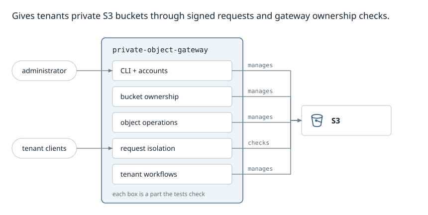

# Multi-tenant gateway for private S3 buckets

Rebuild an S3-compatible gateway that verifies tenant signatures, enforces bucket ownership and forwards allowed requests using shared backend credentials.

## The program
`private-object-gateway` lets several customers use one upstream S3 service through separate access keys. `program ... s3 ...` runs the foreground HTTP gateway; `program admin ...` manages accounts and bucket ownership through its port. S3 holds tenant objects, an internal metadata bucket with ownership, policy, CORS and website records and a separate account bucket containing `users.json`. The gateway enforces tenant boundaries because upstream requests all use backend credentials.

## What the solver gets
The solver gets a working executable to run but not read, an interface guide and a local AWS-compatible emulator. The guide supplies invocation, supported S3 calls and JSON storage layouts, leaving response errors and edge cases to observation. Source and executable `build.sh` must live under `/app`, with an offline build producing `/app/program` in any installed language. Only `/app` carries over to grading.

## What must be rebuilt

- **CLI + accounts**: Match startup prerequisites and the root-authorized admin commands: create, update, delete and list users, list buckets with owners, reassign or create buckets for an owner. Persist account fields in `users.json`, reject duplicates, unknown accounts and invalid roles, honour `user`, `userplus` and `admin` roles, and use accounts prepared before startup.
- **bucket ownership**: Implement CreateBucket, HeadBucket and tenant-scoped ListBuckets. Write ownership and grant records, distinguish owner and foreign name conflicts, and protect the internal metadata bucket.
- **bucket lifecycle**: Delete empty buckets and refuse non-empty ones.
- **object operations**: Forward owner PUT/GET/HEAD/DELETE operations with exact bytes, content types, standard headers, user metadata, checksums and ETags. Support ranges, conditional requests, response overrides, copies, batch deletes, object attributes and tags. Support both object-listing versions, prefixes, delimiters, start-after, pagination and keys needing URL encoding.
- **multipart uploads**: Create, upload and copy parts, list parts and open uploads, complete with part validation, and abort.
- **versioning**: Configure bucket versioning, return version IDs, read and delete specific versions, and list versions and delete markers.
- **bucket configuration and access**: Store and serve bucket policies, CORS and website configurations as metadata records, ACLs in ownership records and ownership controls upstream. Make policies, ACL grants and canned ACLs open exactly the access they state to other tenants and unsigned clients, reject malformed policies and ACLs that ownership controls forbid, and accept presigned URLs.
- **request isolation**: Verify SigV4 signatures and signing region. Deny foreign, internal, unregistered and missing buckets, plus absent signatures, unknown keys and wrong secrets, with the expected statuses and S3 error codes.
- **tenant workflows**: Keep interleaved valid and forged requests independent. Preserve accounts and ownership after restart, and make accounts added during service usable without exposing existing tenants' buckets.

## How it is graded
Hidden tests start a gateway with fresh metadata and account buckets, create at least two tenants through the admin client and drive their S3 requests with boto3. They compare HTTP statuses, S3 error codes, object bytes, headers, version IDs, tag sets, part and upload listings, admin exit statuses and account and bucket rows with reference behavior. Direct upstream inspection checks data and JSON records after operations, including refusals. Forged signatures and attempts to overwrite another tenant's objects or internal records must leave upstream state unchanged. Restart sequences reuse existing state.

## Why it is hard
Authentication and ownership checks must precede forwarding while preserving S3 response behavior across a wide operation surface. Policies and ACL grants add a second authorization layer that must match the reference's decisions request by request. URL encoding affects signature verification, in headers and in presigned query strings, as well as object identity. Account persistence, role and owner changes, late account creation and restart must retain the same boundaries.

## Real-world basis
Modelled on an open-source object-storage gateway with an S3-compatible API and configurable storage backends.

## Task facts

| | |
|---|---|
| Task | `swe-cloud/pc-s3-multitenant-object-gateway` |
| Type | Program construction |
| AWS services | S3 |
| Language | Any installed language |
| Runtime | Local AWS-compatible emulator. No internet access. |
| Hidden tests | 167 test functions |
| Agent time limit | 4 hours |
| Resources | 2 CPUs, 4 GB memory |
