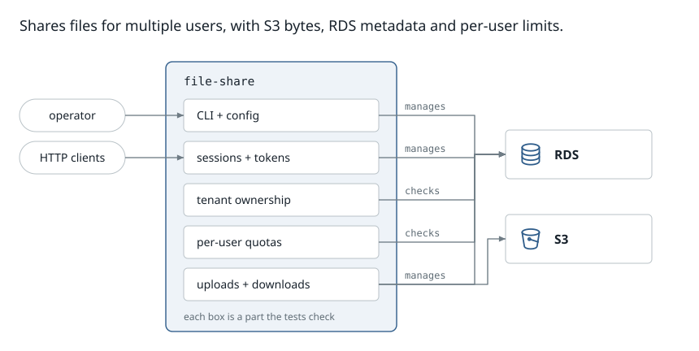

# Multi-tenant file sharing with S3 and RDS

Several users share one file server; rebuild its HTTP API, maintenance CLI, S3 storage options, upload lifetime and cleaning, upload ownership and per-user quotas while preserving deliberate download sharing.

## The program
`file-share` is a foreground HTTP server for users who upload files and distribute download links. `program --config settings.toml` selects TOML settings, S3 storage for bytes and RDS for metadata. Operators use `user create|list|show|update|delete`, `token create|list|delete`, `file list|show|delete`, `clean` and `export`/`import` against the same database and bucket. Users authenticate with password sessions, API tokens or a CLI login flow; administrators manage everyone.

## What the solver gets
The solver gets a working build to run but not read, an interface guide and a local AWS-compatible emulator providing S3 and RDS. The guide defines commands, endpoints and observed tables but leaves exact errors and ownership decisions open. Source and an executable `build.sh` go under `/app`; the offline build must produce `/app/program` using any installed language. Only `/app` transfers to grading.

## What must be rebuilt

- **CLI + config**: Provision users, set size limits and manage tokens in RDS. Match CLI output and refusal statuses, configuration selection, port overrides and exposed feature settings.
- **sessions + tokens**: Implement login, logout, XSRF checks and session-only account endpoints. Token listings and revocation belong to the current user; revoked tokens stop working.
- **tenant ownership**: Keep upload listings, statistics and bulk removal within the caller's account. Management distinguishes the creating token from other tokens, while owner sessions, upload capabilities and removable uploads have their tested permissions.
- **per-user quotas**: Count uploaded bytes separately for each owner, including capability uploads. Match inclusive boundaries, declared-size checks, live CLI limit changes, deletion recovery and metadata left by refused files.
- **uploads + downloads**: Create uploads, fill pre-declared files and store exact S3 bytes with RDS file records. Match quick-upload links, metadata, GET/HEAD, ranges and dispositions, password protection, one-shot downloads, zip archives, streaming uploads and file versus upload deletion.
- **S3 storage**: Name objects with or without a prefix, fall back to legacy keys, create the bucket, write large files as multipart uploads, apply SSE-S3 or per-file SSE-C keys and delete exact versions on versioned buckets.
- **lifetime + cleaning**: Apply default, maximum and per-user TTLs, report expired uploads, extend TTLs on download, and let `clean` expire uploads, delete removed objects and purge metadata.
- **options + limits**: Honour the disabled/enabled/forced feature flags for upload options, per-file and per-user file size limits and the per-upload file count.
- **admin + CLI**: Serve the admin API and impersonation, profile updates, account deletion and the CLI login flow; match `file`, `user delete`, `clean` and `export`/`import` subcommands.

## How it is graded
Hidden tests create a fresh RDS database, S3 bucket and server configuration, provision multiple users and exercise CLI commands and HTTP requests. They compare exit statuses, selected output, response bodies, cookies, headers, downloaded bytes, database rows and S3 keys and contents with reference behavior. Refused foreign mutations must preserve the other user's state. Public download links and explicit sharing capabilities are intentional exceptions. S3 objects and rows are compared before and after the `clean` command; the server's own cleaning timer is outside observation.

## Why it is hard
The program is broad: dozens of endpoints, flags and subcommands, each with exact refusal texts and side effects. An account's API tokens are not interchangeable upload administrators, deleted data lingers in S3 and Postgres until cleaning, and storage options change what lands in S3. These details must agree across HTTP, CLI and storage.

## Real-world basis
Modelled on an open-source file-sharing server with local accounts, downloadable links and configurable storage backends.

## Task facts

| | |
|---|---|
| Task | `swe-cloud/pc-s3-rds-multitenant-file-share` |
| Type | Program construction |
| AWS services | RDS, S3 |
| Language | Any installed language |
| Runtime | Local AWS-compatible emulator with live service engines. No internet access. |
| Hidden tests | 165 test functions |
| Agent time limit | 4 hours |
| Resources | 4 CPUs, 8 GB memory |
