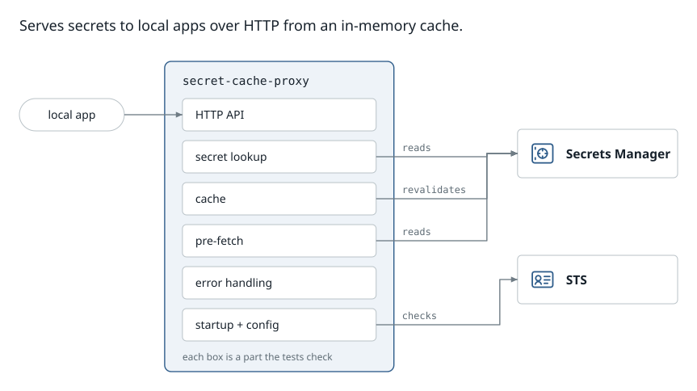

# Local Secrets Manager caching HTTP proxy

Serves token-protected secret lookups from a local cache; rebuild HTTP behavior, secret retrieval, expiry, pre-fetch, service-failure handling and startup checks.

## The program
`secret-cache-proxy` is a foreground service for local applications that need Secrets Manager values. `program sm start --config file.toml` opens a loopback HTTP listener. Clients use `/secretsmanager/get?secretId=...` or a configurable path form, providing a token header. The proxy caches values in memory, can pre-fetch secrets, and normally checks credentials through STS before listening.

## What the solver gets
The solver gets a working executable to run but not read, an interface guide and a local AWS-compatible emulator. The guide describes TOML keys, requests and observation rules while leaving cache transitions and exact failure responses open. Any installed language is allowed. Source and executable `build.sh` must be under `/app`, with an offline build producing `/app/program`. Only `/app` transfers into verification.

## What must be rebuilt
- **HTTP API**: Match token discovery and validation, forwarding-header rejection, routes, methods and parameter parsing. Respect custom headers, token files, path prefixes and limits on open connections.
- **secret lookup**: Return exact secret documents for names, ARNs, binary values, versions and staging labels. Match path versus query decoding, repeated parameters and region selection.
- **cache**: Reproduce entry keys, TTL expiry, forced refresh, write-order eviction and label moves. Match whether each request causes `DescribeSecret`, `GetSecretValue` or no service call, including deletion and recreation cases.
- **pre-fetch**: Use `BatchGetSecretValue` at startup for configured identifiers and tag keys. Respect batches, pagination, shared capacity budgets, buffer ratios and the accepted configuration layout.
- **error handling**: Translate service and connection failures into the expected status and body. Retain cached entries and serve stale values when the configured transient-error behavior permits it.
- **startup + config**: Support defaults and nested or flat TOML, validate keys and bounds, check credentials through STS, and report readiness. Disabled capability, missing tokens, occupied ports and shutdown signals need their prescribed outcomes.

## How it is graded
Hidden tests create and change secrets, start proxies, send HTTP requests and compare responses with the reference build. A forwarding endpoint records AWS operations and injects service errors or refused connections. Checks cover request-level call sequences, pre-fetch arguments and continuation tokens, exact error bodies, cached documents, readiness and exit statuses. Time-controlled scenarios exercise expiry and version-label changes; retry counts for failing calls are not compared.

## Why it is hard
Identical HTTP values can conceal different cache behavior. Revalidation calls, unchanged versions, cached staging labels, failed refreshes and eviction must match alongside response formatting. Pre-fetch capacity and request decoding add further interactions that require observation.

## Real-world basis
Modelled on an open-source local AWS credentials and secrets provider with a caching Secrets Manager capability.

## Task facts

| | |
|---|---|
| Task | `swe-cloud/pc-secretsmanager-secret-cache-proxy` |
| Type | Program construction |
| AWS services | Secrets Manager, STS |
| Language | Any installed language |
| Runtime | Local AWS-compatible emulator. No internet access. |
| Hidden tests | 62 test functions |
| Agent time limit | 4 hours |
| Resources | 2 CPUs, 4 GB memory |
