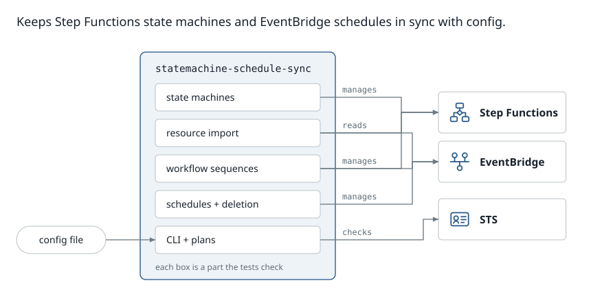

# State machine and schedule configuration sync

Keeps Step Functions state machines and EventBridge Scheduler schedules aligned with configuration; the solver rebuilds its planning, apply and import behavior.

## The program
`statemachine-schedule-sync` is a CLI for operators managing workflows from a declarative configuration file. Its `plan`, `apply` and `import` commands use Step Functions, EventBridge Scheduler and STS account identity. It keeps no state file: each run compares configuration with AWS. Resources disappear only through explicit deletion flags.

## What the solver gets
The solver gets a working build to run as a black box, an interface guide and a local AWS-compatible emulator. The guide describes configuration fields, commands and comparison rules while leaving normalization and failure effects to observation. Source and an executable `/app/build.sh` must live under `/app`; the script produces `/app/program` offline using any installed language. Only `/app` transfers to grading.

## What must be rebuilt
- **state machines**: Create and update definitions, roles, logging and tracing, and reconcile tags. Preserve the observed behavior for type changes and optional fields that prevent convergence.
- **resource import**: Write existing machines and optional schedules into a configuration document, retaining evaluated existing entries. Reject duplicates and leave files untouched on import errors.
- **workflow sequences**: Handle mixed create, update and delete plans in configuration order, target filtering and repeated runs. Support import, edit and apply sequences while preserving unrelated resources.
- **schedules + deletion**: Reconcile schedule expressions, groups, windows, targets and dates. Honor `deleteSchedule` and `deleteAll`, including omitted schedule blocks and failures after machine creation.
- **CLI + plans**: Evaluate configuration and external strings, select targets, print resource diffs and write `--diff-as-json` reports. Confirmation accepts exactly `yes`; cancellation changes no AWS resources.

## How it is graded
Hidden tests create fresh machines and schedule groups, write configurations and invoke commands with controlled stdin. They check exit statuses, meaningful stdout diff lines, operation summaries, parsed JSON reports and imported files. AWS reads independently verify definitions, tags and schedule fields. Cancellation, invalid configuration and missing schedule groups exercise failure effects, including a created machine surviving a failed schedule creation.

## Why it is hard
The rebuild must match remote defaults and explicit nulls, rather than merely create valid resources. Tag ordering, optional logging fields, immutable machine types, deletion combinations and partial failure can make a plausible implementation disagree with subsequent plans.

## Real-world basis
Modelled on an open-source declarative deployment CLI for workflow state machines and their schedules.

## Task facts

| | |
|---|---|
| Task | `swe-cloud/pc-sfn-eventbridge-workflow-schedule-sync` |
| Type | Program construction |
| AWS services | Step Functions, EventBridge, STS |
| Language | Any installed language |
| Runtime | Local AWS-compatible emulator. No internet access. |
| Hidden tests | 44 test functions |
| Agent time limit | 4 hours |
| Resources | 2 CPUs, 4 GB memory |
