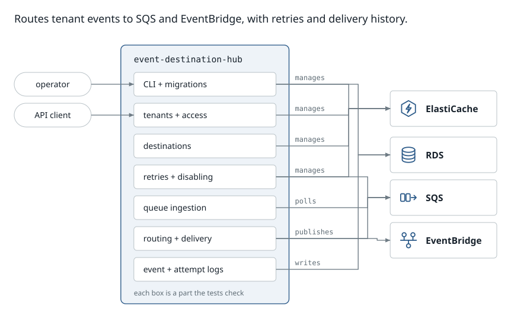

# Tenant event delivery and history service

Routes tenant events to SQS queues and EventBridge buses; the solver rebuilds the API, durable records, delivery workers, retries and queryable history.

## The program
`event-destination-hub` serves applications that register destinations and publish events through a REST API or an SQS publish queue. `program serve` runs the API and workers after `migrate apply --yes`. ElastiCache holds tenant and destination records, internal SQS queues carry deliveries and logs, and RDS stores event and attempt history. Configuration comes from environment variables.

## What the solver gets
A working build can be run as a black box against a local AWS-compatible emulator. Interface, API, routing and delivery guides describe the public surface, leaving validation details, record layouts and timing to observation. The solver writes source and `/app/build.sh` under `/app`, producing `/app/program` offline with any installed language. Grading retains only `/app` and supplies fresh resources.

## What must be rebuilt
- **CLI + migrations**: Reproduce migration planning, confirmation, application, verification and stale-lock handling. Inspect resolved configuration with secrets masked and refuse startup with pending migrations.
- **tenants + access**: Create, update and soft-delete tenants, preserving the required ElastiCache record layout. Enforce admin authentication and tenant-token scope.
- **destinations**: Validate and store destination configuration, credentials, metadata, filters and topic subscriptions. Support partial updates, limits, enable/disable and deletion, with encrypted stored credentials.
- **retries + disabling**: Apply scheduled and exponential retries, manual retry validation and consecutive-failure disabling. Respect the log-batch delay floor and reset failure streaks after success.
- **queue ingestion**: Provision delivery and log queues with dead-letter queues, consume publish messages and limit failed redeliveries. Reuse queues and preserve state across restarts.
- **routing + delivery**: Match topics, wildcards, filters and enabled state, and recognize duplicate event IDs. Deliver exact SQS body text, metadata attributes and EventBridge envelopes.
- **event + attempt logs**: Persist event and attempt rows with the required schema. Provide scoped queries, filters, related records and cursor pagination, retaining history after destination deletion.

## How it is graded
Hidden tests provision fresh backing stores, queues and buses, run migrations and start the service. They compare API statuses and JSON errors, destination messages, ElastiCache records, RDS schemas and rows, and CLI output. Missing destinations, repeated failures and restarts exercise retries, automatic disabling and persistence; timing is checked within tolerances.

## Why it is hard
API correctness must agree with asynchronous queue delivery and two persistent stores. Exact validation bodies, encrypted fields, filter semantics, retry timing and pagination all remain observable beyond a successful publish response.

## Real-world basis
Modelled on an open-source event destination service for routing application events to tenant-managed infrastructure.

## Task facts

| | |
|---|---|
| Task | `swe-cloud/pc-sqs-eventbridge-event-delivery-hub` |
| Type | Program construction |
| AWS services | ElastiCache, RDS, SQS, EventBridge |
| Language | Any installed language |
| Runtime | Local AWS-compatible emulator with live service engines. No internet access. |
| Hidden tests | 60 test functions |
| Agent time limit | 4 hours |
| Resources | 4 CPUs, 8 GB memory |
