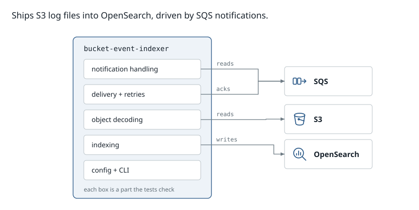

# SQS driven S3 log object indexer

Turns S3 objects announced through SQS into OpenSearch documents; the solver rebuilds decoding, indexing, retry and acknowledgement behavior.

## The program
`bucket-event-indexer` is a long-running log shipper for operators collecting object-based logs. `program --config PATH` polls SQS notifications, downloads the announced S3 objects and sends decoded events through the OpenSearch bulk API. `program validate` checks configuration and optional endpoint health. TOML, YAML and JSON files describe one source-to-sink pipeline, including framing, compression, index routing and acknowledgement settings.

## What the solver gets
The solver gets a working build to run as a black box, an interface guide and a local AWS-compatible emulator with provisioned OpenSearch endpoints. The guide describes supported options but leaves their exact effects, field precedence and failure handling to observation. Source and `/app/build.sh` must be under `/app`, building `/app/program` offline with any installed language. Only `/app` transfers to fresh grading resources.

## What must be rebuilt
- **notification handling**: Read direct S3 notifications and SNS-wrapped notifications, URL-decode keys and handle multiple records in order. Preserve malformed or unprocessable messages for redelivery and respect `delete_message`.
- **delivery + retries**: Coordinate SQS deletion with sink outcomes and failed-message retention. Match whole-request retries, partial-item retries, batching, disabled acknowledgements and recovery after restart.
- **object decoding**: Fetch objects and split bytes or JSON content into events, including custom delimiters and multiline modes. Match timestamps, metadata precedence, gzip and zstd selection, concatenated compressed content and corrupt-object retention.
- **indexing**: Form document IDs, index and action templates, field filters and data-stream fields. Preserve overwrite versions, create conflicts, fallback indices and the treatment of rejected events.
- **config + CLI**: Select the parser from the file extension and implement validation with optional health checks and warning rejection. Match configuration-error exit status 78 and graceful signal shutdown.

## How it is graded
Hidden tests create fresh buckets, notification queues and OpenSearch indices, upload objects and run configured pipelines. They compare document indices, IDs, sources and versions, then inspect retained notifications and receive counts. An HTTP intermediary records bulk action/document sequences and injects whole-request errors or failed individual items. Validation commands and signal termination are also checked; diagnostic logs are excluded.

## Why it is hard
Object metadata, decoded JSON and generated fields compete for the same names. Sink retries must remain distinguishable from SQS redelivery, especially when timestamps and document versions expose repeated processing. Partial failures and acknowledgement settings connect every stage of the pipeline.

## Real-world basis
Modelled on a widely used open-source observability data pipeline with object-storage sources and search indexing sinks.

## Task facts

| | |
|---|---|
| Task | `swe-cloud/pc-sqs-opensearch-object-event-indexer` |
| Type | Program construction |
| AWS services | SQS, S3, OpenSearch |
| Language | Any installed language |
| Runtime | Local AWS-compatible emulator with live service engines. No internet access. |
| Hidden tests | 60 test functions |
| Agent time limit | 4 hours |
| Resources | 4 CPUs, 8 GB memory |
